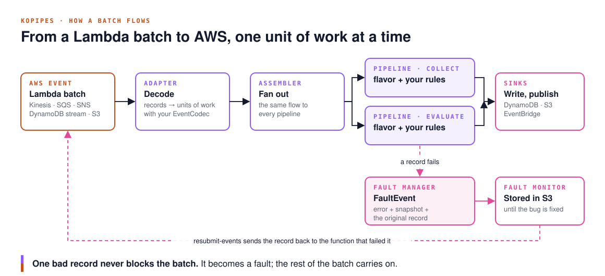

# kopipes: AWS Lambda Stream for the JVM

A Kotlin-first, Java-friendly framework for building reliable, serverless, event-driven systems on AWS.

kopipes (packages `io.kopipes.*`) brings John Gilbert's
[aws-lambda-stream](https://github.com/jgilbert01/aws-lambda-stream) patterns to the JVM.

> **Status:** a work in progress, not yet published to Maven Central. Feedback, ideas and experimental use are
> welcome.

## Why

Every event-driven Lambda needs the same plumbing: decode a batch, filter it, call AWS in parallel and in batches,
retry what's transient, stop one bad record from blocking a stream, recover it once the bug is fixed, replay
history, keep consumers idempotent. Teams that write it by hand write it differently every time.

kopipes gives you that plumbing as ready-made **pipelines** you configure with your rules, and a set of
**service patterns** that tell you how to put them together:

- **One bad record never blocks a stream.** It becomes a fault event with a full snapshot. Fix the bug, then
  resubmit the record to the function that failed it.
- **Services that keep working when others don't.** Each service records what it hears in its own events table
  and acts from there, never calling another service synchronously.
- **Idempotent by design**, so retries, redeliveries and replays are safe.
- **Deadlines without schedulers**, built from DynamoDB TTL.
- **Testable without AWS.** No global state, in-memory fakes, plain unit tests.
- **Batteries included:** envelope encryption, claim check, circuit breaker, rate limiter, EMF metrics, CDK
  constructs and optional Spring Boot support.

## How it works



An adapter turns the Lambda's batch into a `Flow` of units of work; each pipeline picks the events it wants and does
one job; failures become fault events, and the rest of the batch carries on. [How kopipes works](docs/Concepts.md)
explains it in one page, with a glossary.

## A taste

A control service's listener: save every payment event to the service's events table, keyed by payment.

```kotlin
class ListenerContainer(
    val context: AwsKopipesContext = AwsKopipesContext(),            // config, AWS clients, publisher, faults
    val eventsMicrostore: EventsMicrostore = DynamoDbEventsMicrostore(context),
) {
    val assembler = PipelineAssembler.builder()
        .context(context)
        .addPipeline(
            CollectPipeline.builder()
                .id("collect")
                .eventFilter(EventFilters.classes(PaymentEvent::class))
                .correlationKey { uow -> (uow.event as PaymentEvent).payment.id }
                .eventsMicrostore(eventsMicrostore)
                .build()
        )
        .build()

    val kinesisAdapter = KinesisAdapter(context, PaymentsEventCodec)
}

class Listener(
    containerFactory: () -> ListenerContainer = { ListenerContainer() },
) : RequestHandler<KinesisEvent, Void?> {
    private val container by lazy(containerFactory)              // built once per Lambda container

    override fun handleRequest(input: KinesisEvent, context: Context): Void? = runBlocking {
        container.assembler.assemble(container.kinesisAdapter.fromKinesis(input)).collect()
        null
    }
}
```

In a test, build the handler with in-memory fakes and call it: no AWS, no mocks.

```kotlin
val table = EventsMicrostoreInMemory()
val listener = Listener { ListenerContainer(AwsKopipesContext(eventPublisher = EventPublisherInMemory()), table) }
listener.handleRequest(kinesisEventOf(submitted), TestContext())   // helper: see the Kotlin guide
table.getStored().keys shouldBe setOf(submitted.id)
```

## Installation

kopipes isn't published to a repository yet. Use it from source with a Gradle
[composite build](https://docs.gradle.org/current/userguide/composite_builds.html):

```kotlin
// settings.gradle.kts
includeBuild("../aws-lambda-stream-kotlin")
```

```kotlin
// build.gradle.kts
dependencies {
    implementation("io.kopipes.aws:aws:1.0")                  // brings io.kopipes:core:1.0
    implementation(platform("aws.sdk.kotlin:bom:1.3.15"))
    implementation("aws.sdk.kotlin:dynamodb")                 // the SDK clients your functions use
    implementation("aws.sdk.kotlin:eventbridge")
    // implementation("io.kopipes.spring:spring:1.0")         // optional Spring Boot support
}

kotlin { jvmToolchain(21) }
```

Requirements: **JDK 21**, for Kotlin (2.2) and Java projects alike. The `aws` module declares the AWS
SDK for Kotlin clients as `compileOnly`, so a function ships only the clients it uses: add the ones you need. Lambda
functions run as shadow (fat) jars; see the [Wiring pitfalls](docs/Wiring.md#pitfalls) for the `META-INF/services`
files they must merge.

## Where to start

| You are... | Read |
|---|---|
| Evaluating it | [How kopipes works](docs/Concepts.md), [Features](docs/Features.md), the [Payments example](examples/payments/README.md) |
| An architect | [Software Architects Guide](docs/SoftwareArchitects.md): benefits, patterns, trade-offs |
| A Kotlin developer | [Kotlin Developers Guide](docs/KotlinDevelopers.md), then [Pipelines](docs/Pipelines.md) and [Wiring](docs/Wiring.md) |
| A Java developer | [Java Developers Guide](docs/JavaDevelopers.md), then [Pipelines](docs/Pipelines.md) and [Wiring](docs/Wiring.md) |
| Using Spring Boot | The [spring module](spring/README.md) |
| Writing infrastructure | The [cdk module](cdk/README.md) |
| Running it in production | [Fault Re-submission](docs/FaultResubmission.md), [Replaying Events](docs/ReplayEvents.md), [Deadlines](docs/Deadlines.md) |

## Examples

- **[Payments](examples/payments/README.md)** (Kotlin): a complete subsystem, with a control service, a BFF, four
  gateways, an event hub, an event lake and a fault monitor. It uses deadlines, a circuit breaker and a rate limiter,
  and runs end to end on LocalStack. Start here.
- **[SUT](examples/sut)** (Kotlin): a smaller system tracking serialized units, plus a regional health check.
- **[URL Shortener](examples/urlshortener)** (Java): the framework and the CDK constructs from Java.

## Project structure

| Module | What it holds |
|---|---|
| [core](core) | Pipelines, events, faults and the in-memory test doubles. No AWS or Spring dependency |
| [aws](aws) | Adapters, sinks, connectors and the AWS pipeline flavors |
| [spring](spring/README.md) | Optional Spring Boot auto-configuration and Lambda handlers |
| [cdk](cdk/README.md) | CDK constructs for the event hub, event lake, fault monitor, tables and functions |
| [tools](tools) | `resubmit-events` and `replay-events` |
| [examples](examples) | Example systems in Kotlin and Java |
| [docs](docs/README.md) | The documentation, indexed by role and topic |

## Background

The framework follows the serverless architecture patterns in John Gilbert's [book](https://a.co/d/0cgkIieB),
*Software Architecture Patterns for Serverless Systems* ([how each pattern maps to kopipes](docs/BookPatterns.md)), and
[blog](https://medium.com/@jgilbert001), and uses his [TypeScript framework](https://github.com/jgilbert01/aws-lambda-stream)
as its reference.
