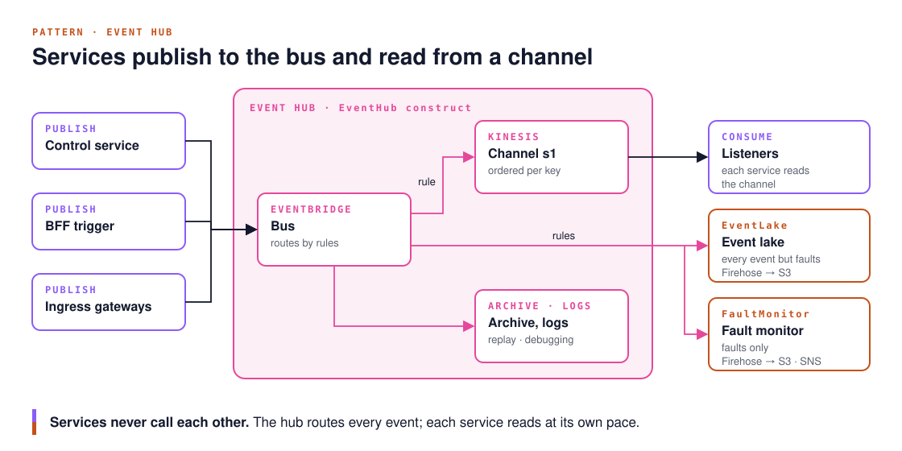

# Autonomous Service Patterns

Every service in a subsystem follows one of three patterns from *Software Architecture Patterns for Serverless
Systems*: a **BFF** serves a human actor, an **external service gateway** serves an outside system, and a **control
service** holds the business process. A few shared components (the event hub, the event lake, the fault monitor and
the regional health check) support them. This page describes each one and how kopipes builds it.

## Table of Contents

- [Control Services](#control-services)
- [Backends for Frontends (BFFs)](#backends-for-frontends-bffs)
- [External Service Gateways](#external-service-gateways)
  - [Ingress Gateways](#ingress-gateways)
  - [Egress Gateways](#egress-gateways)
- [Event Hubs](#event-hubs)
- [Event Lake](#event-lake)
- [Fault Monitoring Services](#fault-monitoring-services)
- [Regional Health Check](#regional-health-check)

## Control Services

A control service runs a business process. It is purely asynchronous: it consumes lower-order events from boundary
services, decides what should happen, and emits higher-order events that tell them what to do next. It never calls
anyone. It answers to the people who own the business policy, not to a user interface (Ch. 8).

The book breaks its work into six steps. kopipes has a flavor for each:

| Step | What it does | kopipes |
|---|---|---|
| **Collect** | Save every event of interest, keyed by event id, so a repeat writes the same item | `CollectPipeline` in the **listener** |
| **Correlate** | Group events by a key, usually the entity id | `CorrelatePipeline` in the **trigger** |
| **Collate** | Order the correlated events by time | Sort `uow.correlated` by `timestamp` in the rule |
| **Evaluate** | Decide whether the events heard so far call for an action | `EvaluatePipeline.expression { ... }` |
| **Emit** | Publish higher-order events, with deterministic ids | `EvaluatePipeline.emit { ... }`, `oneEventPerCorrelationKey()` |
| **Expire** | Clean up with TTL, and fire timers when an expected event never arrives | `ttlDays`; [Deadlines](Deadlines.md) with `onExpired()` |

**Orchestration.** Simple flows can be choreographed: each service reacts to the last one's events. When the process
has real logic (steps, branches, deadlines, compensation), move it into a control service. It emits an *entry* event
for each step (`WITHDRAWAL_REQUESTED`) and waits for the step's *exit* event (`FUNDS_WITHDRAWN`). Any service that
honours the pair can do the work, so a step's implementer can be replaced without touching the process.

**Sagas.** When a step can't go forward, its service emits an *abort* event (`DEPOSIT_FAILED`): an expected outcome,
not a fault. The control service knows which steps already succeeded and emits events that compensate exactly those
(`REFUND_REQUESTED`). Compensations are new facts, not rollbacks.

The [payments control service](../examples/payments/README.md) is a complete example: entry and exit events per step,
a deadline per step, and a refund when the deposit fails.

## Backends for Frontends (BFFs)

A BFF serves **one human actor's activity**, typically one screen or micro app, and is owned by the team that owns
that frontend (Ch. 6). It owns its data, in the shape its frontend needs, so it answers even when the services behind
it are down. A BFF that only forwards calls to other services is a facade, and keeps their outages.

A BFF has up to three faces:

| Face | Does | kopipes |
|---|---|---|
| **Command / query** | The API for its own frontend. Other systems use a gateway, not the BFF's API | Your handler, behind the `RestApi` construct |
| **Listener** (optional) | Keeps views of upstream data up to date from events | `MaterializePipeline` |
| **Trigger** (optional) | Publishes the BFF's own changes as domain events, from its table's stream | `CdcPipeline` |

Writing to its own table first and publishing from the change stream (*database-first* event sourcing) means users
see their change immediately, and the event can never disagree with the data.

## External Service Gateways

An external service gateway (ESG) is the anti-corruption layer between a subsystem and an outside system: a SaaS
provider, a legacy application, another subsystem (Ch. 7). Inside the subsystem, **internal domain events are the
ports and gateways are the adapters**, so outside models, protocols and failures never leak in.

A gateway has two jobs: **connectivity** (protocols, security, sync or async) and **translation** (mapping and
enrichment). It keeps what the outside system sent in the event's `raw` field, so nothing is lost even if it isn't
mapped yet. By default there is one gateway per outside system and direction.

### Ingress Gateways

Turn what an outside system says into internal events, and publish them. Typical flows:

- **Webhook:** the provider calls an API, and the gateway translates the request and publishes. See
  [Fault Re-submission](FaultResubmission.md#what-the-function-receives) for resubmitting a failed webhook.
- **Change data capture:** read a legacy database's change log and combine row changes into domain events.
- **Another subsystem's external events**, translated into this subsystem's internal ones.

In kopipes, a `TranslatePipeline` turns each outside record into events.

### Egress Gateways

Turn internal events into calls to an outside system, or into external events for another subsystem. Typical flows:

- **API call:** filter the events, map them to requests, and call the provider at a rate it accepts. Don't announce
  success from the call itself; wait for the provider's answer (often a webhook to the ingress partner).
- **Circuit breaker:** stop calling a system that is down, and let events wait in the stream until it recovers. The
  book uses breakers only here, never between your own services.
- **External events:** translate internal events into the subsystem's public ones and forward them to other
  subsystems' buses.

In kopipes, an `ActionPipeline` makes the calls, with `RateLimiter` and `CircuitBreaker` (both with their state in
DynamoDB, shared by every container). A `CdcPipeline` or `EvaluatePipeline` emits external events, and the
`EventForwarding` construct routes them.

## Event Hubs

The event hub is the centre of a subsystem. Producers publish to the **bus** and know nothing else; **rules** route
events to **channels** (Kinesis streams); each consumer reads a channel at its own pace (Ch. 4). The bus is the
outbound bulkhead: a producer publishes and forgets, and a slow or broken consumer never affects it.

- **Start with one channel.** Add more only for a reason: isolation, very large events, priority, volume, or too many
  consumers on one stream.
- **A stream between the bus and the functions** gives batching, ordering per key, and control over concurrency.
- **Faults get their own route,** so large fault events don't crowd the main channel.

The `EventHub` construct builds the bus, the default channel `s1`, an archive and log groups. See the
[cdk module](../cdk/README.md).

## Event Lake

The event lake keeps **every event of the subsystem, forever**, in S3: the audit trail, the source for analytics, and
the source for replays (Ch. 4). Services never query it in real time. See [Event Lake](EventLake.md) and
[Replaying Events](ReplayEvents.md).

## Fault Monitoring Services

A fault monitor stores the fault events that functions publish when a record can't be processed, so an operator can
find the cause, fix it and resubmit the records. The hub acts as the dead-letter queue, and good records keep
flowing. See [Fault Re-submission](FaultResubmission.md).

## Regional Health Check

The regional health check gives one signal for whether a region can take traffic, from error alarms and a tracer that
crosses every service the region uses (Ch. 9). See [Regional Health Check](RegionalHealthCheck.md).

## Example Implementation

- [Payments](../examples/payments/README.md): every pattern on this page in one subsystem.
- [SUT example architecture](../examples/sut/architecture.md): a smaller system with the regional health check.
