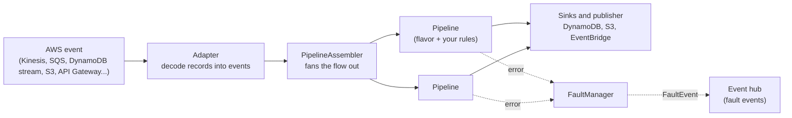

# How kopipes works

kopipes (the packages are `io.kopipes.*`) is the name of this framework, AWS Lambda Stream for the JVM. This page
is the mental model: what happens to a batch of records, the pieces involved, and the words the rest of the docs
use. Read it before the guides.

## The flow of a batch

A Lambda function receives a batch of records from a stream, a queue, a table's stream or an HTTP request. kopipes
turns the batch into a `Flow` of units of work, runs it through your pipelines, and sends the results to AWS.

1. **An adapter** (`KinesisAdapter`, `DynamodbAdapter`, `SqsAdapter`...) turns each record into a `UnitOfWork`,
   decoding the payload into an `Event` with your `EventCodec`. The original record stays in the unit of work.
2. **The assembler** hands the same flow to every pipeline you registered. Each pipeline picks the units of work it
   cares about with an event filter.
3. **Each pipeline** is a *flavor* (collect, correlate, evaluate, materialize...) configured with your rules: which
   events, what key, what to write or emit. The flavor does the plumbing: batching, parallel calls, retries.
4. **Sinks and the publisher** write to DynamoDB or S3 and publish new events to the bus.
5. **When something fails** for one unit of work, the fault manager turns it into a `FaultEvent`, with a snapshot of
   the unit of work and its original record, and the rest of the batch carries on. The fault goes to the bus, a
   fault monitor stores it, and once the bug is fixed the resubmit tool sends the record back to the function.

Errors you mark as retryable (throttling, "the answer came before the request") don't become faults when
`STREAM_RETRY_ENABLED=true`: the batch fails, and the stream delivers it again.

## The building blocks

| Piece | What it is | Where it lives |
|---|---|---|
| `Event` | The interface your events implement: an envelope (`id`, `timestamp`, `partitionKey`, `tags`, `raw`, `eem`, `triggers`) plus your fields | `core` |
| `EventCodec` | Encodes and decodes your events (kotlinx.serialization, Jackson, anything) | `core` |
| `UnitOfWork` | What flows through a pipeline: the event, the original record, the pipeline, and what each step added (requests, responses, correlated events) | `core` |
| Adapter | Turns a Lambda input into a `Flow<UnitOfWork>` | `aws` (`io.kopipes.aws.from`) |
| Pipeline flavor | A ready-made pipeline you configure with a builder. See [Pipelines](Pipelines.md) | `core` and `aws` |
| `PipelineAssembler` | Runs several pipelines over one flow, and flushes faults at the end | `core` |
| Sink, connector | Writes to an AWS service in batches, with retries | `aws` |
| `EventPublisher` | Publishes events to the bus (`EventBridgePublisher`; `EventPublisherInMemory` in tests) | `core`, `aws` |
| `EventsMicrostore` | A service's own events table in DynamoDB: what it heard, by correlation key | `core`, `aws` |
| `FaultManager` | Turns errors into fault events, or rethrows the retryable ones | `core` |
| `AwsKopipesContext` | Everything the pipelines share: config, AWS clients, publisher, fault manager. See [Wiring](Wiring.md) | `aws` |
| Container | Your class that builds the pipelines from a context, once per Lambda container | your code |

## A service is a few functions and a table

Most services follow one of a handful of shapes ([Autonomous Service Patterns](AutonomousServicePatterns.md)), and
each shape maps to a few flavors:

| Service | Functions | Flavors |
|---|---|---|
| Control service | **listener**: stream → events table. **trigger**: table stream → rules → bus | `CollectPipeline`; `CorrelatePipeline`, `EvaluatePipeline` |
| BFF | **listener**: stream → read model. **trigger**: read model changes → bus. An API | `MaterializePipeline`; `CdcPipeline` |
| Ingress gateway | Outside system (webhook, CDC, file) → internal events | `TranslatePipeline` |
| Egress gateway | Internal events → calls to an outside system | `ActionPipeline` |

The [payments example](../examples/payments/README.md) builds one of each.

## Why it's built this way

- **Write first, act later.** A listener only records what it heard; a trigger reacts to the table's stream. A
  service never acts on a fact it hasn't saved, and a redelivered record writes the same item again.
- **Idempotent by default.** Events carry ids; emitted events can have deterministic ids, so a rule that fires again
  (in a replay, say) emits the same event and consumers drop the repeat.
- **One bad record doesn't block the stream.** It becomes a fault you can inspect and resubmit.
- **No global state.** Every component takes its collaborators in its constructor, so the same code runs on Lambda,
  in Spring, or in a unit test with in-memory fakes.

## Glossary

| Term | Meaning |
|---|---|
| **Autonomous service** | A service that owns its data and talks to others only through events, so it keeps working when they're down |
| **Subsystem** | A group of services behind one event hub; subsystems talk through external events or APIs |
| **Event hub** | The subsystem's EventBridge bus plus Kinesis channels that services read from |
| **Domain event** | A business fact, in the past tense (`PAYMENT_SUBMITTED`). Internal ones stay in the subsystem; external ones are a public contract. See [Events](Events.md) |
| **Higher-order event** | An event a rule emits after looking at others (`PAYMENT_COMPLETED`); its `triggers` point at them |
| **Flavor** | A ready-made pipeline type you configure. See [Pipelines](Pipelines.md) |
| **Unit of work** | One record's trip through a pipeline, with everything known about it so far |
| **Events microstore** | A service's own DynamoDB table of events it has heard. See [Events Microstore](EventsMicrostore.md) |
| **Collect** | Save an event in the microstore under its own id |
| **Correlation key** | What groups events, usually the entity id (`p-7`) |
| **Correlate** | Save an event again under its correlation key, so a rule can query everything heard for that key |
| **Evaluate** | Run a rule over the correlated events and emit higher-order events |
| **Deadline** | A correlated item with a TTL; its deletion triggers an expiry rule. See [Deadlines](Deadlines.md) |
| **Materialize** | Keep a read model (a DynamoDB table or S3 objects) up to date from events |
| **CDC** | Change data capture: publish events from a table's own changes (the outbox pattern) |
| **ESG** | External service gateway: the anti-corruption layer between a subsystem and an outside system, ingress or egress |
| **BFF** | Backend for frontend: a service with an API and its own read model |
| **Fault** | A `FaultEvent`: an error, plus a snapshot of the unit of work and its original record |
| **Fault monitor** | The service that stores faults in S3. See [Fault Re-submission](FaultResubmission.md) |
| **Resubmit** | Send faulted records back to the function that failed them |
| **Event lake** | Every event of the subsystem, archived in S3. See [Event Lake](EventLake.md) |
| **Replay** | Send archived events from the lake to one function again. See [Replaying Events](ReplayEvents.md) |
| **Claim check** | A large payload stored in S3, with only a reference in the event. See [Claim Check](ClaimCheck.md) |
| **eem** | Envelope encryption metadata: which fields are encrypted, and the encrypted data keys. See [Encryption](Encryption.md) |
| **Context** | `AwsKopipesContext`: the shared collaborators. See [Wiring](Wiring.md) |
| **Container** | Your class that wires a function's pipelines from a context |
