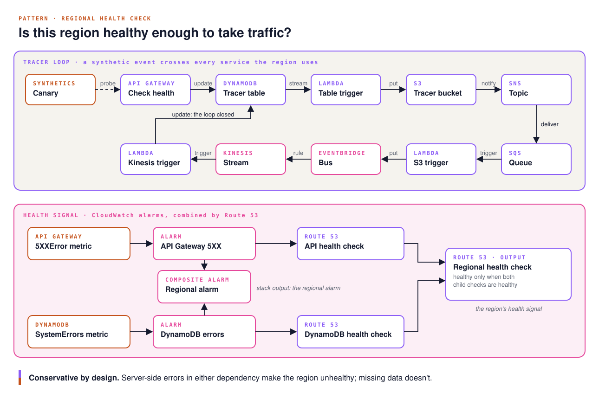

# Regional Health Check

## Purpose

The Regional Health Check provides a high-level health signal for a deployed regional service stack. It combines service-level health indicators from key AWS resources into a single regional status that can be used for monitoring, routing decisions, operational dashboards, and incident response.

The health check is designed to answer one primary question:

> Is this regional deployment healthy enough to receive and process traffic?

It does this by monitoring failures in critical resources such as API Gateway and DynamoDB, then aggregating those signals into a regional health result.

## Why a regional check

In a serverless system there are no machines to check: AWS runs and scales Lambda, API Gateway and DynamoDB for
you. What can fail is a **cloud service in a region**, and when it does there is nothing to fix or restart. The
only remedy is to send traffic to another region. So the check works one level up: it asks whether every cloud
service the subsystem relies on is healthy in this region, and marks the **whole region** unhealthy if any one of them
isn't. Transactions should not criss-cross regions to route around one broken service (*Software Architecture
Patterns for Serverless Systems*, Ch. 9 › *Checking regional health*).

The check combines two signals:

- **Error metrics** from the services that publish good ones: API Gateway `5XXError`, DynamoDB `SystemErrors`.
- **A tracer** for the services whose metrics don't show an outage: a synthetic canary, running in the *other*
  region, calls a health API every minute; the call writes a tracer item that travels through DynamoDB streams, S3,
  SNS, SQS, EventBridge and Kinesis and back to the table. If the previous tracer didn't make it round, the next
  check fails.



## High-Level Overview

The Regional Health Check is built around CloudWatch alarms and Route 53 health checks.

At a high level:

1. API Gateway emits service metrics to CloudWatch.
2. DynamoDB emits table metrics to CloudWatch.
3. CloudWatch alarms evaluate whether those resources are producing server-side errors.
4. Route 53 health checks track the state of those CloudWatch alarms.
5. A calculated Route 53 health check combines the child checks into one regional health status.
6. The regional health check ID and alarm are exposed as stack outputs for use by other systems.

## Main Resources

### API Gateway 5XX Alarm

API Gateway is monitored for `5XXError` responses.

A 5XX error indicates that the API layer is returning server-side failures. These failures may be caused by API Gateway itself, backend integrations, Lambda errors, authorization issues, or other service-side problems.

The alarm evaluates the sum of 5XX errors over a rolling window. If any 5XX errors occur during the configured evaluation period, the alarm enters the `ALARM` state.

This alarm is treated as a signal that the regional API path may be unhealthy.

### API Gateway Health Check

A Route 53 health check is attached to the API Gateway CloudWatch alarm.

This health check does not make a direct HTTP request to the API. Instead, it watches the CloudWatch alarm state. If the API Gateway 5XX alarm is healthy, the health check is healthy. If the alarm is in an alarm state, the health check becomes unhealthy.

This allows API health to be represented as a Route 53-compatible health signal.

### DynamoDB 5XX Alarm

DynamoDB is monitored for `SystemErrors`.

System errors represent service-side DynamoDB failures. These are different from expected client-side errors such as validation errors, conditional check failures, or throttling behavior.

The alarm evaluates whether DynamoDB reports system errors for the regional entities table. If system errors are detected during the configured evaluation period, the alarm enters the `ALARM` state.

This alarm is treated as a signal that the persistence layer may be unhealthy.

### DynamoDB Health Check

A Route 53 health check is attached to the DynamoDB CloudWatch alarm.

Like the API Gateway health check, this is a CloudWatch metric health check rather than an active request. It follows the state of the DynamoDB alarm and contributes to the overall regional health result.

### Regional Composite Alarm

A regional composite CloudWatch alarm combines the API Gateway and DynamoDB alarm states.

The regional alarm enters the `ALARM` state when either of the following is true:

- API Gateway is producing 5XX errors.
- DynamoDB is producing system errors.

This provides a single CloudWatch alarm that represents whether any critical regional dependency is showing server-side failures.

### Calculated Regional Health Check

The calculated Route 53 health check combines the child health checks into a single regional health check.

The child checks are:

- API Gateway health check
- DynamoDB health check

The calculated health check uses a health threshold that requires both child checks to be healthy. If either child check becomes unhealthy, the calculated regional health check becomes unhealthy.

This final calculated health check is the main regional health signal.

## Data Flow

The data flow is metric-driven rather than request-driven.

```text
Client traffic
      | 
      v 
 API Gateway 
      | 
      v 
 CloudWatch API Gateway metrics
      | 
      v 
API Gateway 5XX alarm
     | 
     v 
API Gateway Route 53 health check
```

```text 
Application reads/writes 
     |
     v 
DynamoDB entities table 
     | 
     v 
CloudWatch DynamoDB metrics 
     | 
     v 
DynamoDB SystemErrors alarm 
     |
     v 
DynamoDB Route 53 health check
```

The two health-check paths are then combined into a single calculated health check.

1. API Gateway health check
2. DynamoDB health check

The calculated health check becomes the regional health status for the stack.

## Supporting Resource Flow

The regional stack also includes supporting event and storage resources that participate in the broader service flow.

```text
S3 bucket
     | 
     v 
SNS topic
     | 
     v 
SQS trigger queue
```

This flow allows S3-originated notifications to be published to SNS and delivered to an SQS queue for downstream processing.

The stack also contains eventing resources:

```text
 Application or service event 
     | 
     v 
 EventBridge event bus 
     | 
     v 
 Kinesis stream
 ```

This allows events placed on the regional event bus to be forwarded to a Kinesis stream for downstream consumers.

The DynamoDB entities table can also emit stream records:

```text
DynamoDB entities table
     |
     v
DynamoDB stream
     |
     v
Lambda consumer
```


This supports reactive processing when entity records are inserted, modified, or removed.

## Health Evaluation Behavior

The Regional Health Check is intentionally conservative.

If either critical dependency reports server-side errors, the region is considered unhealthy:

| Resource    | Metric         | Failure Signal                            |
|-------------|----------------|-------------------------------------------|
| API Gateway | `5XXError`     | API layer is returning server-side errors |
| DynamoDB    | `SystemErrors` | DynamoDB is reporting service-side errors |

Missing metric data is not automatically treated as a failure. The alarms are configured so that missing data does not cause a breach by itself. This helps avoid false positives during quiet traffic periods.

## Outputs

The stack exposes outputs for the regional health resources:

- The regional CloudWatch health alarm
- The calculated Route 53 health check ID

These outputs allow other stacks, deployment systems, dashboards, or DNS routing configurations to reference the regional health signal.

## Operational Use Cases

The Regional Health Check can be used for:

- Regional availability monitoring
- Multi-region failover decisions
- Route 53 routing policies
- Deployment validation
- Incident detection
- Dashboards and operational visibility
- Automated remediation workflows

## Tuning and testing

- **Avoid flapping.** Thresholds and evaluation periods that are too sensitive make traffic fail over and back on
  every blip. Require errors over several consecutive periods.
- **Test the failover.** Inject failures (chaos tests) and run regular failover drills, so the first real failover
  isn't the first one.
- **Expect a few minutes.** Alarms, health checks and DNS take minutes to move traffic. Frontends that work offline
  and services that tolerate eventual consistency carry users through the gap.

## Summary

The Regional Health Check aggregates resource-level failure indicators into a single regional health signal.

It monitors:

- API Gateway server-side failures
- DynamoDB service-side failures

Those signals flow through:

1. CloudWatch metrics
2. CloudWatch alarms
3. Route 53 child health checks
4. A calculated Route 53 regional health check

The result is a simple, reusable health signal that represents whether the regional deployment is healthy enough to serve traffic.

## Example

See the [Regional Health Check section](../examples/sut/architecture.md#regional-health-check-tracer-loop) in the SUT Example Architecture for a practical implementation scenario.

