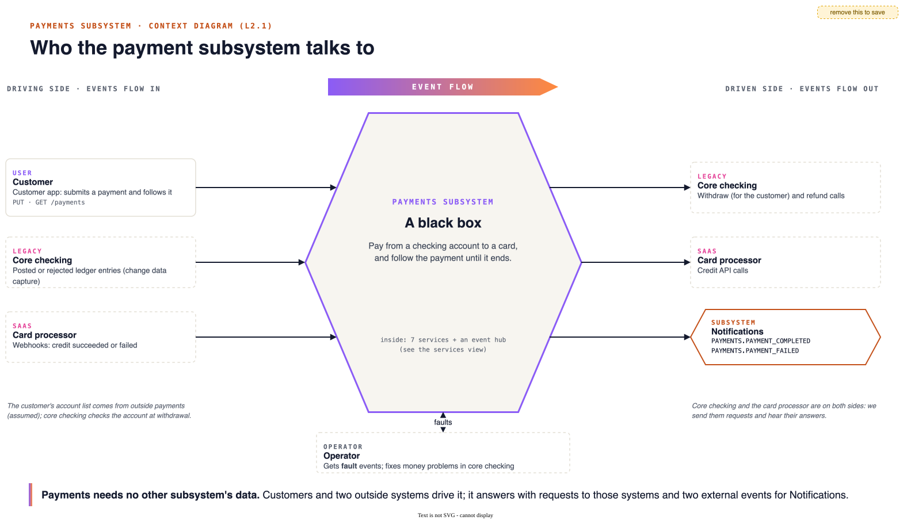
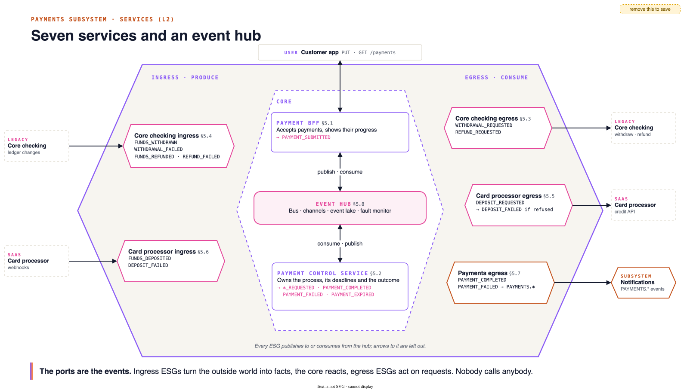

# Payments Service Specifications (L2)

*The payments subsystem seen from the [subsystem hexagon (L2)](Subsystem_Hexagon_Guidelines.md): its common components, its internal and external events, and one black-box spec per service. A minimal teaching core for the book's patterns and the kopipes framework. The level above is [PaymentsSystemSpecs.md](PaymentsSystemSpecs.md); keep the two consistent.*

**What's the book's and what's ours:** the envelope, the `fault` event, the service patterns (BFF, control service, ESG, event hub), entry/exit/abort events, deterministic ids and `PUT` with client-generated ids are the book's. The event names, fields, reasons, REST paths and views are **ours**.
**Every service is a black box:** what goes in, what comes out, what can be observed, what is guaranteed. Never functions, tables, keys, timers, products or frameworks (L2.16).
**Running example:** payment `p-7`, 100 USD from checking account `C-1` to card `K-2`.

## Contents

1. [Context](#1-context)
2. [Common components](#2-common-components)
3. [Events](#3-events)
4. [Services](#4-services)
5. [Service specs](#5-service-specs)
6. [Decisions](#6-decisions)

---

## 1. Context

From the [L1 spec](PaymentsSystemSpecs.md#5-subsystem-specs): the customer is the dominant actor; the operator gets `fault` events and fixes money problems in core checking ([L1 D10](PaymentsSystemSpecs.md#7-decisions)); payments owns core checking and the card processor; it produces `PAYMENTS.PAYMENT_COMPLETED` and `PAYMENTS.PAYMENT_FAILED` for Notifications and consumes nothing; one region, one account.



| Outside actor | Side | Why |
|---|---|---|
| Customer | Driving | Submits and follows payments through the customer app |
| Core checking | Both | Driven: we ask it to withdraw and refund. Driving: its ledger changes flow in |
| Card processor | Both | Driven: we ask it to credit the card. Driving: its results flow in by webhook |
| Notifications | Driven | Gets `PAYMENTS.*` |
| Operator | Beside the hexagon | Gets faults through the fault monitor, a common component; fixes money problems in core checking itself, so the fix flows back in as a ledger change |

An outside system that both receives and sends appears on both sides, as the book draws it (Ch. 7 › [Macro-level ports and adapters](Chapter_07_Bridging_Intersystem_Gaps.md#macro-level-ports-and-adapters)), and gets an ingress and an egress ESG.

---

## 2. Common components

Infrastructure with no business rules, beside the hexagon (L2.5). One region, so none of the multi-regional set (L2.2).

| Component | Why | Spec |
|---|---|---|
| **Event hub** `payments-event-hub` | The only thing connecting the services | [Full spec](#58-event-hub) |
| **Event lake** `payments-event-lake` | Keeps every event except `fault`, for audit and replay | Reused as in `sut` |
| **Fault monitor** `payments-event-fault-monitor` | Collects `fault` events for the operator; its operational entry resubmits faults from unreadable input | Reused as in `sut` |
| Observability resources | The one domain alert: the rate of `PAYMENT_EXPIRED` by `step` (Ch. 12 › [Domain event metrics](Chapter_12_Optimizing_Observability.md#domain-event-metrics)) | One line |
| Global resources | The public endpoints the BFF and the card processor's webhook sit behind | One line |
| Pipeline resources | CI/CD | Named only |

Not included: the main app (the customer app isn't designed here) and the regional health check (one region).

---

## 3. Events

### Envelope

The book's (Ch. 4 › [Event envelope](Chapter_04_Trusting_Facts_and_Eventual_Consistency.md#event-envelope)):

| Field | In this subsystem |
|---|---|
| `id` | Deterministic: the same fact always gets the same id |
| `type` | Upper snake case (`PAYMENT_SUBMITTED`); external ones prefixed `PAYMENTS.`; `fault` keeps the framework's name |
| `timestamp` | When the fact happened, not when it was heard |
| `partitionKey` | The payment id |
| `tags` | `source` is always the producing service |
| `payment` | The payment snapshot (below) |
| `raw` | The outside system's original data, unchanged. Only on events from ingress ESGs; never external |

### Payment payload

Every payment event carries the payment as it is, so no consumer ever calls back (L2.4).

```json
"payment": {
  "id": "p-7",
  "customerId": "u-42",
  "from": { "kind": "checking", "account": "C-1" },
  "to":   { "kind": "card", "account": "K-2" },
  "amount": "100.00",
  "currency": "USD",
  "submittedAt": 1730900520000
}
```

- `from.kind` is always `checking` and `to.kind` always `card` for now; the kinds leave room for other sources and destinations.
- `amount` is a decimal string with two decimals, never a binary floating-point number.

### Internal events

| Event | Kind | Producer | Consumers | Own fields |
|---|---|---|---|---|
| `PAYMENT_SUBMITTED` | Fact | BFF | Control service | — |
| `WITHDRAWAL_REQUESTED` | Entry | Control service | Core checking egress, core checking ingress (for the snapshot) | — |
| `FUNDS_WITHDRAWN` | Exit | Core checking ingress | Control service, BFF | — |
| `WITHDRAWAL_FAILED` | Abort | Core checking ingress | Control service, BFF | `reason` |
| `DEPOSIT_REQUESTED` | Entry | Control service | Card processor egress, card processor ingress (for the snapshot), BFF | — |
| `FUNDS_DEPOSITED` | Exit | Card processor ingress | Control service, BFF | — |
| `DEPOSIT_FAILED` | Abort | Card processor ingress; card processor egress on a `4xx` | Control service, BFF | `reason` |
| `REFUND_REQUESTED` | Compensate | Control service | Core checking egress, BFF | — |
| `FUNDS_REFUNDED` | Exit | Core checking ingress | Control service, BFF | — |
| `REFUND_FAILED` | Abort | Core checking ingress | Control service, BFF | `reason` |
| `PAYMENT_COMPLETED` | Outcome | Control service | BFF, payments egress ESG | — |
| `PAYMENT_FAILED` | Outcome | Control service | BFF, payments egress ESG | `reason`, copied from the failure that caused it |
| `PAYMENT_EXPIRED` | Expired | Control service | BFF | `step`: `withdrawal` · `deposit` · `refund` |
| `fault` | Error | Any service | Fault monitor | The framework's format |

**Internal `reason`:** `insufficient-funds` · `account-closed` · `account-not-found` (also someone else's account) · `card-declined` (any card failure, refused or declined) · `rejected` (anything else).

### External events

| Event | Direction | Producer | Consumers | Translated from |
|---|---|---|---|---|
| `PAYMENTS.PAYMENT_COMPLETED` | Out | Payments egress ESG | Notifications | `PAYMENT_COMPLETED` |
| `PAYMENTS.PAYMENT_FAILED` | Out | Payments egress ESG | Notifications | `PAYMENT_FAILED` |

- Nothing comes in. Only outcomes go out: step events, `PAYMENT_EXPIRED` and `REFUND_FAILED` stay inside.
- **Kept:** `payment.id`, `customerId`, `amount`, `currency`, `submittedAt`. **Dropped:** `from`, `to`, `raw`. **Mapped:** `reason` — `insufficient-funds` stays, everything else becomes `rejected`. The format is in the [L1 catalog](PaymentsSystemSpecs.md#4-external-event-catalog).

### Rules every service follows

- **At least once, any order** (L2.14): every consumer is idempotent and order tolerant; views never go backwards; event ids are deterministic.
- **No lost and no phantom facts** (L2.15): publish only what was recorded, and eventually everything recorded. A poison input becomes a `fault`; the stream keeps moving.
- **Nobody calls anybody** (L2.6): the only synchronous entries are the customer → BFF, the card processor → its ingress ESG's webhook, and the operator → the fault monitor.

### Simulation mode

Ours, to run and test without the real outside systems; the test-only exception in L2.6.

- Each egress ESG that talks to an outside system has one setting, **simulate**: off by default, never on in production.
- With simulate on, it **doesn't contact the outside system**. After a delay (set per outside system), it produces the answer that system would have sent, **in that system's own format**, and delivers it to **its ingress partner's real input**. The ingress ESGs don't change and can't tell the difference.
- The answer depends only on the account:

| Account | Simulated answer |
|---|---|
| `C-2` | Withdrawal rejected: insufficient funds |
| `C-9` | Withdrawal rejected: someone else's account (`account-not-found`) |
| `K-3` | Card credit declined. Starts the refund |
| `K-4` | Card request **refused outright** (`4xx`, an invalid card): the card egress ESG itself emits `DEPOSIT_FAILED` (S3). Starts the refund |
| `C-5` | Withdrawal succeeds, but the **refund** is rejected (account closed). Pair it with `K-3` |
| `K-7` | Card credited, but **after** the deposit deadline: `PAYMENT_EXPIRED`, then a late `PAYMENT_COMPLETED` |
| any other | Success |

- **Not simulated yet:** outside systems down or slow (circuit breaker, retries), and the guarantees that depend on them. They stand, but proving them needs fault simulation.

---

## 4. Services



| # | Service | Pattern | Answers to | Consumes | Produces |
|---|---|---|---|---|---|
| 1 | `payments-bff` | BFF | The customer | Every step's exit and abort, `DEPOSIT_REQUESTED`, `REFUND_REQUESTED`, `PAYMENT_EXPIRED`, the outcomes | `PAYMENT_SUBMITTED` |
| 2 | `payments-control-service` | Control service | The business | `PAYMENT_SUBMITTED`, every step's exit and abort | The entries, the outcomes, `PAYMENT_EXPIRED`, `fault` |
| 3 | `payments-core-checking-egress-gateway` | ESG egress (legacy) | Core checking | `WITHDRAWAL_REQUESTED`, `REFUND_REQUESTED` | Nothing; `fault` on a timeout |
| 4 | `payments-core-checking-ingress-gateway` | ESG ingress (legacy, CDC) | Core checking | Ledger changes, `WITHDRAWAL_REQUESTED` | `FUNDS_WITHDRAWN`, `WITHDRAWAL_FAILED`, `FUNDS_REFUNDED`, `REFUND_FAILED` |
| 5 | `payments-card-processor-egress-gateway` | ESG egress (third-party) | The card processor | `DEPOSIT_REQUESTED` | `DEPOSIT_FAILED` on a `4xx` only |
| 6 | `payments-card-processor-ingress-gateway` | ESG ingress (third-party, webhook) | The card processor | Webhooks, `DEPOSIT_REQUESTED` | `FUNDS_DEPOSITED`, `DEPOSIT_FAILED` |
| 7 | `payments-egress-gateway` | ESG egress (subsystem) | Downstream subsystems | `PAYMENT_COMPLETED`, `PAYMENT_FAILED` | `PAYMENTS.PAYMENT_COMPLETED`, `PAYMENTS.PAYMENT_FAILED` |
| 8 | `payments-event-hub` | Common component | Every service | All | Nothing (routes) |

---

## 5. Service specs

### 5.1 Payment BFF

*The customer's only way in: accepts payments and shows their progress as facts arrive.*

| | |
|---|---|
| **Pattern** | BFF |
| **Name** | `payments-bff` |
| **Answers to** | The customer |
| **Owned by** | The customer app's team |

#### Synchronous API

| Method and path | What it does | Response |
|---|---|---|
| `PUT /payments/{id}` | Submit a payment. **The client generates the id**, so a retried request is still one payment | `202 Accepted` + the view (`status: SUBMITTED`). Accepted, never "done" |
| `GET /payments/{id}` | One payment | `200` + the view; `404` if unknown |
| `GET /payments` | The customer's payments, newest first | `200` + a list of views |

Request body of `PUT`:

```json
{ "from": { "kind": "checking", "account": "C-1" },
  "to":   { "kind": "card", "account": "K-2" },
  "amount": "100.00", "currency": "USD" }
```

- The id comes from the path, `customerId` from the caller's identity, `submittedAt` from the BFF's clock. Unknown fields are ignored.
- **The caller's identity** is the `X-Customer-Id` header for now: a stand-in for an access token so the example stays on events. It's not authentication and must not ship; a real token check (Ch. 10) replaces it without changing this contract.

| Status | `error` | When |
|---|---|---|
| `400` | `invalid-request` | Malformed body, amount ≤ 0, a `from` that isn't a checking account, a `to` that isn't a card (`field` names the culprit) |
| `401` | `unauthenticated` | No `X-Customer-Id` |
| `404` | `not-found` | No such payment **for this customer** (another customer's payment is `404`, not `403`, so ids can't be probed) |
| `409` | `conflict` | The same id was already used with a different body |

- **Validation checks only the request's shape**, with nothing but the request (L2.10). Whether the account exists, is open and is the customer's is core checking's call, at withdrawal.

**The view:**

```json
{
  "id": "p-7", "status": "SENT_TO_CARD",
  "amount": "100.00", "currency": "USD",
  "to": { "kind": "card", "account": "K-2" },
  "steps": [
    { "step": "submitted", "at": 1730900520000, "state": "done" },
    { "step": "withdrawn", "at": 1730900580000, "state": "done" },
    { "step": "deposited", "state": "pending" }
  ]
}
```

Each step shows its event's `timestamp`: when it happened, not when the BFF heard it.

#### Consumes

| Event | Shows |
|---|---|
| `FUNDS_WITHDRAWN` · `WITHDRAWAL_FAILED` | Step *withdrawn* done · failed with its `reason` |
| `DEPOSIT_REQUESTED` | Step *deposited* pending |
| `FUNDS_DEPOSITED` · `DEPOSIT_FAILED` | Step *deposited* done · failed with its `reason` |
| `REFUND_REQUESTED` · `FUNDS_REFUNDED` · `REFUND_FAILED` | Step *refunded* pending · done · failed |
| `PAYMENT_EXPIRED` | "Delayed" on the step named by `step` |
| `PAYMENT_COMPLETED` · `PAYMENT_FAILED` | The outcome |

#### Status

`status` depends **only on which events the BFF has heard**, never on their order. The first row that matches wins:

| # | If it has heard… | `status` | The customer reads |
|---|---|---|---|
| 1 | `PAYMENT_FAILED` | `FAILED` (with its `reason`) | The payment failed; any money taken is back |
| 2 | `PAYMENT_COMPLETED` | `COMPLETED` | Paid |
| 3 | `REFUND_FAILED` and not `FUNDS_REFUNDED`, **or** `PAYMENT_EXPIRED` for a step whose exit or abort it hasn't heard | `DELAYED` | Taking longer than usual; we're on it. **Not final** |
| 4 | `DEPOSIT_FAILED`, `REFUND_REQUESTED` or `FUNDS_REFUNDED` | `REFUNDING` | Returning your money |
| 5 | `DEPOSIT_REQUESTED` | `SENT_TO_CARD` | On its way to the card |
| 6 | `FUNDS_WITHDRAWN` | `WITHDRAWN` | Taken from your account |
| 7 | Nothing yet | `SUBMITTED` | Received |

- **Only the control service decides the outcome** (L2.11): `COMPLETED` comes only from `PAYMENT_COMPLETED`, `FAILED` only from `PAYMENT_FAILED`. A `WITHDRAWAL_FAILED` shows on its step; the status waits for `PAYMENT_FAILED`.
- **One `DELAYED` for the customer**, whether a person must step in (`REFUND_FAILED`) or an outside system is late (`PAYMENT_EXPIRED`): for them it's the same. The operator tells them apart through the `fault` and the expiry alert. The steps list shows which step is stuck.
- `DELAYED` sits above `REFUNDING`, so a late refund shows as delayed.

#### Produces

| Event | When | Payload notes |
|---|---|---|
| `PAYMENT_SUBMITTED` | The first accepted `PUT` for an id. A repeated `PUT` publishes nothing | `payment` from the body, the path id, the caller's `customerId` and the BFF's `submittedAt` |

#### Guarantees

- **Duplicate input:** a repeated `PUT` with the same body returns the stored view; with a different body, `409`. A duplicate event changes nothing.
- **Late or out-of-order input:** never makes the view go backwards; `status` follows the table.
- **Event id:** one payment, one `PAYMENT_SUBMITTED` id, however often the request is retried.
- **Accepted means published:** once `PUT` has returned `202`, `PAYMENT_SUBMITTED` is published, even if the bus was down at that moment (L2.10).

#### Failure behaviour

| Situation | What happens |
|---|---|
| The bus is down | `PUT` still returns `202`; `PAYMENT_SUBMITTED` is published once the bus is back |
| The rest of the subsystem is down | Payments are still accepted; views stop moving until it's back |
| An event it can't read | Skipped; a `fault`; the stream keeps moving |

**Sources:** Ch. 6 › [REST](Chapter_06_A_Best_Friend_for_the_Frontend.md#rest); Ch. 5 › [Implementing idempotence and order tolerance](Chapter_05_Turning_the_Cloud_into_the_Database.md#implementing-idempotence-and-order-tolerance); Ch. 4 › [Order tolerance and idempotence](Chapter_04_Trusting_Facts_and_Eventual_Consistency.md#order-tolerance-and-idempotence).

### 5.2 Payment control service

*Owns the payment process: which step comes next, the refund, and the deadlines. Nothing calls it.*

| | |
|---|---|
| **Pattern** | Control service |
| **Name** | `payments-control-service` |
| **Answers to** | The business (the payment process) |
| **Owned by** | The payments team |

#### Synchronous API

**None.** It only consumes and produces events (L2.11).

#### Consumes

| Event | Means |
|---|---|
| `PAYMENT_SUBMITTED` | Start |
| `FUNDS_WITHDRAWN` · `WITHDRAWAL_FAILED` | The withdrawal's exit · abort |
| `FUNDS_DEPOSITED` · `DEPOSIT_FAILED` | The deposit's exit · abort |
| `FUNDS_REFUNDED` · `REFUND_FAILED` | The refund's exit · abort |

#### Produces

| Event | When (see [Rules](#rules)) | Payload notes |
|---|---|---|
| `WITHDRAWAL_REQUESTED` | *Start* | `payment` |
| `DEPOSIT_REQUESTED` | *Next step* | `payment` |
| `REFUND_REQUESTED` | *Compensate* | `payment` |
| `PAYMENT_COMPLETED` | *Done* | `payment` |
| `PAYMENT_FAILED` | *Nothing to undo*, *Undone* | `payment`, `reason` copied from the abort that caused it |
| `PAYMENT_EXPIRED` | *Expired* | `payment`, `step` |
| `fault` | *Conflict*, *Refund failed* | The payment's events, for the operator |

#### Rules

Each rule depends only on what has been heard for the payment, never on arrival order (L2.12). **Conflict is checked first:** once a step's exit and abort have both been heard, no other rule fires for the payment (S15).

| Rule | When it has heard… | It emits |
|---|---|---|
| Start | `PAYMENT_SUBMITTED` | `WITHDRAWAL_REQUESTED` |
| Next step | `FUNDS_WITHDRAWN` | `DEPOSIT_REQUESTED` |
| Nothing to undo | `WITHDRAWAL_FAILED` | `PAYMENT_FAILED` |
| Done | `FUNDS_DEPOSITED` | `PAYMENT_COMPLETED` |
| Compensate | `DEPOSIT_FAILED` | `REFUND_REQUESTED` |
| Undone | `FUNDS_REFUNDED` | `PAYMENT_FAILED` (the deposit's `reason`) |
| Refund failed | `REFUND_FAILED`, and not `FUNDS_REFUNDED` | `fault`, and **no outcome yet**: the money is still owed. The operator posts the refund **in core checking** with the payment's reference (S14); the ledger change comes in as `FUNDS_REFUNDED`, and *Undone* fires |
| Conflict | The exit **and** the abort of the withdrawal, or of the deposit | `fault`, and **nothing more for this payment**: no rule fires for it again. The operator sorts it out by hand |
| Expired | A step's entry, and by its deadline neither its exit nor its abort | `PAYMENT_EXPIRED` with that `step` |

**Decision table** (Ch. 8 › [Decision tables](Chapter_08_Reacting_to_Events_with_More_Events.md#decision-tables)): what each step's answers lead to. Each cell is a test case.

| Step | Exit only | Abort only | Both |
|---|---|---|---|
| Withdrawal | `DEPOSIT_REQUESTED` | `PAYMENT_FAILED` | `fault` (*Conflict*) |
| Deposit | `PAYMENT_COMPLETED` | `REFUND_REQUESTED` | `fault` (*Conflict*) |
| Refund | `PAYMENT_FAILED` | `fault` (*Refund failed*) | `PAYMENT_FAILED`: the operator's fix landed |
| Neither, past the deadline | `PAYMENT_EXPIRED` | | |

- **At most one outcome per payment.** The second answer of a conflicting pair can arrive after the first one's rule already fired (for example `PAYMENT_COMPLETED` is out, then `DEPOSIT_FAILED` arrives). *Conflict* then emits only a `fault` and stops the payment, so no second outcome is ever published.
- **A deadline is not an outcome** (Ch. 8 › [expire](Chapter_08_Reacting_to_Events_with_More_Events.md#expire)). The rules keep running after `PAYMENT_EXPIRED`: a late exit or abort is handled as usual. Only the BFF and the expiry alert react to it.
- **Deadlines are configurable per step:** in production 1 day for the withdrawal and the refund (core checking is closed at night) and 1 hour for the card deposit; in demos about 2 minutes. `PAYMENT_EXPIRED` never comes before the deadline and may come somewhat after it; each step's has its own id.

#### Guarantees

- **Duplicate input:** changes nothing.
- **Late or out-of-order input:** a payment's events can arrive in any order; the rules give the same result.
- **Event id:** a rule that fires again emits the same event with the same id, so consumers drop the repeat.

#### Failure behaviour

| Situation | What happens |
|---|---|
| The bus is down | Nothing arrives; it catches up from its channel when the bus is back. Deadlines that passed meanwhile emit `PAYMENT_EXPIRED` then |
| An event it can't read | Skipped; a `fault`; the stream keeps moving |
| A combination the rules don't expect | *Conflict* covers it: `fault` and stop for that payment |

**Sources:** Ch. 8 › [Dissecting the Control Service pattern](Chapter_08_Reacting_to_Events_with_More_Events.md#dissecting-the-control-service-pattern), [Entry and exit events](Chapter_08_Reacting_to_Events_with_More_Events.md#entry-and-exit-events), [Abort events](Chapter_08_Reacting_to_Events_with_More_Events.md#abort-events), [Compensating transactions](Chapter_08_Reacting_to_Events_with_More_Events.md#compensating-transactions), [expire](Chapter_08_Reacting_to_Events_with_More_Events.md#expire).

### 5.3 Core checking egress ESG

*Sends withdrawals and refunds to core checking: a legacy system that closes at night, is sometimes down, and has no idempotency keys.*

| | |
|---|---|
| **Pattern** | ESG, egress, for a legacy system: an API call behind a circuit breaker |
| **Name** | `payments-core-checking-egress-gateway` |
| **Answers to** | Core checking |
| **Owned by** | The team that integrates with core checking |

#### Synchronous API

**None exposed.** It *calls* core checking's withdraw and refund API.

#### Consumes

| Event | Leads to (a call to core checking) |
|---|---|
| `WITHDRAWAL_REQUESTED` | Withdraw `amount` from `from.account` **for `customerId`**, reference `p-7`. Core checking rejects it if the account doesn't exist, isn't this customer's, is closed, or lacks funds |
| `REFUND_REQUESTED` | Credit `amount` back to `from.account`, reference `p-7`. A new ledger entry, not a rollback |

#### Produces

**Nothing when the call goes through.** Act, then hear back (L2.9): the result, posted or rejected, comes from the ledger through the [core checking ingress ESG](#54-core-checking-ingress-esg). Only a `fault`, below.

#### Guarantees

- **Called once per request:** each `WITHDRAWAL_REQUESTED` or `REFUND_REQUESTED` reaches core checking once, even when the event is delivered twice, since core checking can't detect a repeat.
- **Never retried blindly** after an unclear answer (below): a second call could debit twice.

#### Failure behaviour

| Situation | What it does | On our bus |
|---|---|---|
| Core checking down or closed for the night | Stops calling (circuit breaker); requests wait until it's back | Nothing. Past the 1-day deadline, the control service emits `PAYMENT_EXPIRED` |
| **The call times out: did it happen?** | Doesn't call again (S4) | A `fault`: the operator checks the ledger for reference `p-7` and, if nothing was posted, posts it **in core checking** by hand (S14). Either way the ledger change comes in as usual |
| Core checking refuses the call itself (malformed, not a business rejection) | Doesn't retry | A `fault`. Business rejections come through the ledger as usual |
| An event it can't read | Skips it; the stream keeps moving | A `fault` |

#### Simulation

No call. It writes the **ledger entry** core checking would have written (posted or rejected, with core checking's own reject code) to the change feed the core checking ingress ESG reads. See [Simulation mode](#simulation-mode).

**Sources:** Ch. 7 › [Egress – circuit breaker](Chapter_07_Bridging_Intersystem_Gaps.md#egress--circuit-breaker), [Idempotence](Chapter_07_Bridging_Intersystem_Gaps.md#idempotence).

### 5.4 Core checking ingress ESG

*Turns core checking's ledger changes into our events.*

| | |
|---|---|
| **Pattern** | ESG, ingress, for a legacy system: change data capture |
| **Name** | `payments-core-checking-ingress-gateway` |
| **Answers to** | Core checking |
| **Owned by** | The team that integrates with core checking |

#### Synchronous API

**None.** It reads core checking's ledger changes.

#### Consumes

| Input (core checking's ledger, through change data capture) | Leads to |
|---|---|
| A posted debit with reference `p-7` | `FUNDS_WITHDRAWN` |
| A rejected debit with reference `p-7` | `WITHDRAWAL_FAILED` |
| A posted refund credit with reference `p-7` | `FUNDS_REFUNDED` |
| A rejected refund credit with reference `p-7` | `REFUND_FAILED` |
| A ledger change with no payment reference | Nothing: not ours |
| `WITHDRAWAL_REQUESTED` (internal event) | Nothing published: it remembers the payment, to fill in the snapshot of every later event for it |

#### Produces

| Event | When | Payload notes |
|---|---|---|
| `FUNDS_WITHDRAWN` | A posted debit | `payment`; `raw`: the ledger row |
| `WITHDRAWAL_FAILED` | A rejected debit | `payment`, `reason` translated from core checking's reject code (an account that isn't this customer's becomes `account-not-found`); `raw` |
| `FUNDS_REFUNDED` | A posted refund credit | `payment`; `raw` |
| `REFUND_FAILED` | A rejected refund credit | `payment`, `reason`; `raw` |

- **The `payment` snapshot** comes from the `WITHDRAWAL_REQUESTED` it heard for that reference: a ledger row knows only its own entry, not the card or the submitted time (S12). The ESG keeps its own copy, built from events; it never asks another service.
- A reject code it doesn't know becomes `reason: rejected`; the code stays in `raw`.

#### Guarantees

- **Event id:** the same ledger entry always yields the same event id.
- **Unknown fields are ignored** (L2.8): a new column in the ledger doesn't break it; the original row is kept whole in `raw` (Ch. 11 › [The Robustness principle](Chapter_11_Choreographing_Deployment_and_Delivery.md#the-robustness-principle)).
- **No lost facts:** a ledger change counts as handled only once its event is published; after an outage it resumes from there.
- **Any order:** a ledger change that arrives before its `WITHDRAWAL_REQUESTED` waits for it; its event is published once both are heard.

#### Failure behaviour

| Situation | What it does | On our bus |
|---|---|---|
| The bus is down | Stops reading; resumes from the first unpublished change | Nothing until the bus is back; a repeat has the same id |
| Core checking or its change feed is down | Nothing to read; catches up when it's back | Nothing. The control service's deadline emits `PAYMENT_EXPIRED` if it lasts |
| A change with a payment reference it can't read | Skips it; the feed keeps moving | A `fault`, with the row |

**Sources:** Ch. 7 › [Ingress – Change Data Capture](Chapter_07_Bridging_Intersystem_Gaps.md#ingress--change-data-capture), [Idempotence](Chapter_07_Bridging_Intersystem_Gaps.md#idempotence), [Semantic transformation](Chapter_07_Bridging_Intersystem_Gaps.md#semantic-transformation).

### 5.5 Card processor egress ESG

*Sends card credits to the card processor, a third-party service that limits our request rate and answers later by webhook.*

| | |
|---|---|
| **Pattern** | ESG, egress, for a third-party system: an API call |
| **Name** | `payments-card-processor-egress-gateway` |
| **Answers to** | The card processor |
| **Owned by** | The team that integrates with the card processor |

#### Synchronous API

**None exposed.** It *calls* the card processor's credit API.

#### Consumes

| Event | Filter | Leads to (a call to the card processor) |
|---|---|---|
| `DEPOSIT_REQUESTED` | `to.kind = card` | Credit `amount` to `to.account`, with the processor's **idempotency key** set to the payment id (`p-7`). The processor accepts it (`202`) and answers later by webhook |

#### Produces

| Event | When | Payload notes |
|---|---|---|
| `DEPOSIT_FAILED` | Only when the processor **refuses the request itself** (`4xx`, for example an invalid card number) | `payment`, `reason: card-declined` (the same as a declined card); `raw`: the processor's error response |

- Otherwise nothing: an accepted request is a promise, not a fact (L2.9). The result comes by webhook, through the [card processor ingress ESG](#56-card-processor-ingress-esg).

#### Guarantees

- **Credited at most once:** every call and every retry for a payment carries the same idempotency key, so the processor credits the card once, even when the event is delivered twice.
- **Paced:** it sends at the processor's allowed rate and lets the backlog wait.

#### Failure behaviour

| Situation | What it does | On our bus |
|---|---|---|
| The processor is down, times out or answers `5xx` | Retries with backoff, same idempotency key | Nothing. Past the 1-hour deadline, the control service emits `PAYMENT_EXPIRED` |
| The processor answers `429` (too many requests) | Slows down and retries, same key | Nothing |
| The processor refuses the request (`4xx`) | Doesn't retry: an abort, not a fault (S3) | `DEPOSIT_FAILED`, so the refund runs |
| An event it can't read | Skips it; the stream keeps moving | A `fault` |

#### Simulation

No call. After the delay, it posts the **signed webhook** the processor would have sent (credit succeeded, or failed with the processor's failure code) to the card processor ingress ESG's webhook, signed with that ESG's secret. For `K-4` it behaves as if the processor answered `4xx`: no webhook, it emits `DEPOSIT_FAILED` itself. See [Simulation mode](#simulation-mode).

**Sources:** Ch. 7 › [Egress – API call](Chapter_07_Bridging_Intersystem_Gaps.md#egress--api-call), [Idempotence](Chapter_07_Bridging_Intersystem_Gaps.md#idempotence).

### 5.6 Card processor ingress ESG

*Turns the card processor's webhooks into our events.*

| | |
|---|---|
| **Pattern** | ESG, ingress, for a third-party system: webhook |
| **Name** | `payments-card-processor-ingress-gateway` |
| **Answers to** | The card processor |
| **Owned by** | The team that integrates with the card processor |

#### Synchronous API

| Method and path | Called by | What it does |
|---|---|---|
| `POST /webhooks/card-processor` | The card processor only (a signed request) | Checks the signature, turns the callback into our event, and answers `200` **only once the event is published** |

#### Consumes

| Input | Leads to |
|---|---|
| Webhook: credit succeeded, reference `p-7` | `FUNDS_DEPOSITED` |
| Webhook: credit failed, reference `p-7` | `DEPOSIT_FAILED` |
| `DEPOSIT_REQUESTED` (internal event, `to.kind = card`) | Nothing published: it remembers the payment, to fill in the snapshot (S12) |

#### Produces

| Event | When | Payload notes |
|---|---|---|
| `FUNDS_DEPOSITED` | Credit succeeded | `payment`; `raw`: the webhook body |
| `DEPOSIT_FAILED` | Credit failed | `payment`, `reason: card-declined`; `raw`: the webhook body |

#### Guarantees

- **Event id:** derived from the webhook's own event id, so a redelivered webhook is the same event.
- **Answered means published:** `200` only once the event is on the bus. For an ESG, publishing **is** the record (Ch. 4 › [Stream-first event sourcing](Chapter_04_Trusting_Facts_and_Eventual_Consistency.md#stream-first-event-sourcing)), so a callback the processor thinks was delivered is never lost.
- **Unknown fields are ignored** (L2.8); the original body is kept whole in `raw`.

#### Failure behaviour

| Situation | Answer to the processor | On our bus |
|---|---|---|
| A valid, signed callback | `200`, after publishing | `FUNDS_DEPOSITED` or `DEPOSIT_FAILED` |
| The same callback again | `200` | The same event id; consumers drop it |
| The bus is unreachable | `5xx`, so the processor sends it again | Nothing yet |
| A callback for a payment whose `DEPOSIT_REQUESTED` it hasn't heard yet | `5xx`, so the processor sends it again later | Nothing yet |
| A bad or missing signature | `401` | Nothing: it isn't from the processor |
| Signed but unreadable | `200`, after publishing the fault | A `fault`, for the operator to resubmit |

- **The processor resends a callback that doesn't get a `2xx`** *(assumed; webhook providers usually do, the book doesn't say)*.

**Sources:** Ch. 7 › [Ingress – webhook](Chapter_07_Bridging_Intersystem_Gaps.md#ingress--webhook), [Idempotence](Chapter_07_Bridging_Intersystem_Gaps.md#idempotence); Ch. 4 › [Fault events](Chapter_04_Trusting_Facts_and_Eventual_Consistency.md#fault-events).

### 5.7 Payments egress ESG

*Decides what payments tells the rest of the bank, and hides everything else.*

| | |
|---|---|
| **Pattern** | ESG, egress, for downstream subsystems: internal events in, external events out |
| **Name** | `payments-egress-gateway` |
| **Answers to** | Downstream subsystems (today: Notifications) |
| **Also owns** | The **egress rule** on our hub: external `PAYMENTS.*` events → the Notifications hub. One target per downstream subsystem |
| **Owned by** | The payments team, because it owns the contract |

#### Synchronous API

**None.**

#### Consumes

| Event | Leads to |
|---|---|
| `PAYMENT_COMPLETED` | `PAYMENTS.PAYMENT_COMPLETED` |
| `PAYMENT_FAILED` | `PAYMENTS.PAYMENT_FAILED`, with `reason` mapped |

#### Produces

| Event (external) | When | Payload |
|---|---|---|
| `PAYMENTS.PAYMENT_COMPLETED` | `PAYMENT_COMPLETED` heard | The external payload ([L1 catalog](PaymentsSystemSpecs.md#4-external-event-catalog)) |
| `PAYMENTS.PAYMENT_FAILED` | `PAYMENT_FAILED` heard | The same, plus the public `reason` |

- **Kept:** `payment.id`, `customerId`, `amount`, `currency`, `submittedAt`. **Dropped:** `from`, `to` (account and card numbers), `raw`, every step event.
- **Reason mapping** (the talk's curation example):

| Internal `reason` | Public `reason` |
|---|---|
| `insufficient-funds` | `insufficient-funds` |
| `account-closed`, `account-not-found`, `card-declined`, `rejected`, and any new one | `rejected` |

- **Where it goes** (L2.8): it publishes onto **our own hub**, marked external; the egress rule forwards to each downstream hub. Nobody reads our hub.
- Published as a **JSON Schema** for consumers, guarded by their consumer-driven contract tests (Ch. 11 › [Contract testing](Chapter_11_Choreographing_Deployment_and_Delivery.md#contract-testing)).

#### Guarantees

- **Event id:** derived from the internal event's id, so a redelivered internal event gives the same external event.
- **Only outcomes leave:** nothing else this subsystem knows ever crosses.

#### Failure behaviour

| Situation | What it does | On our bus |
|---|---|---|
| An event it can't read | Skips it; the stream keeps moving | A `fault`; **no** external event |

- **Its job ends once the external event is on our hub.** Getting it to the Notifications hub, and retrying if that hub is unreachable, is the [event hub's](#58-event-hub) guarantee.

#### Changing the contract

The talk's example (L1 D8): rename **`submittedAt` → `createdAt`** in three deployments (Ch. 11 › [Between producers and consumers](Chapter_11_Choreographing_Deployment_and_Delivery.md#between-producers-and-consumers)):

1. This ESG publishes **both** `submittedAt` and `createdAt`. Consumers ignore the field they don't know yet.
2. Each downstream team switches to `createdAt`; their contract tests tell us when all have.
3. This ESG stops publishing `submittedAt`.

- **Only this ESG changes.** The internal events, the BFF and the control service keep `submittedAt`: the ESG holds the difference while consumers upgrade.

**Sources:** Ch. 7 › [Egress – upstream subsystem](Chapter_07_Bridging_Intersystem_Gaps.md#egress--upstream-subsystem), [Semantic transformation](Chapter_07_Bridging_Intersystem_Gaps.md#semantic-transformation); Ch. 2 › [External domain events](Chapter_02_Defining_Boundaries_and_Letting_Go.md#external-domain-events); Ch. 11 › [The Robustness principle](Chapter_11_Choreographing_Deployment_and_Delivery.md#the-robustness-principle).

### 5.8 Event hub

*The subsystem's backbone: services publish to one bus, and routing rules decide where each event goes.*

| | |
|---|---|
| **Pattern** | Common component: event hub |
| **Name** | `payments-event-hub` |
| **Answers to** | Every service in the subsystem (infrastructure) |
| **Owned by** | The subsystem's platform team |

#### Synchronous API

**None.** Services **publish** envelope-shaped events to the bus, and each **consumes** from its channel at its own pace.

#### Routing rules

| Rule | Matches | Goes to |
|---|---|---|
| Default channel | Internal events, except `fault` | The stream the domain services read |
| Faults | `fault` | The fault monitor |
| Event lake | Every event, internal and external, except `fault` | The event lake |
| **Egress** *(owned by the [payments egress ESG](#57-payments-egress-esg))* | External events whose type starts with `PAYMENTS.` | The Notifications hub; one target per downstream subsystem |

- **Why the egress rule checks the prefix:** "external" alone would do today, since nothing comes in. The prefix keeps it right if an ingress from another subsystem is added later, so their events are never forwarded on.
- **No ingress channel:** nothing comes in from other subsystems.

#### Produces

**Nothing of its own.** It routes what others publish.

#### Guarantees

- **Delivered, not dropped:** once an event is accepted by the bus, it reaches every channel and target its rules name. Delivery to another subsystem's hub is retried while that hub is unreachable.
- **Channels keep events for days:** a consumer that's down catches up when it's back, without affecting the others.
- **Replay** comes from the lake, to one service only, never to the whole bus.

#### Failure behaviour

| Situation | What happens | Who notices |
|---|---|---|
| A consumer is down or slow | Its channel keeps the events; it catches up later | That consumer's backlog |
| The bus itself is down | Nothing is routed. Producers hold their facts: the BFF still accepts payments, ingress ESGs stop reading or answer `5xx` | Each producer, as its own spec says |
| The Notifications hub is unreachable | Delivery is retried; external events wait | The platform team |
| Writing to the lake fails | Retried; only replays depend on the lake | The platform team |

#### The other common components

- **Event lake** (`payments-event-lake`): keeps every event except `fault`, for audit and replay. As in `sut`.
- **Fault monitor** (`payments-event-fault-monitor`): collects `fault` events; its operational entry lets the operator **resubmit** faults from unreadable input once the cause is fixed (S1). Money problems are fixed in core checking instead (S14). As in `sut`. The hub's routing is the dead-letter queue; nothing special is built (Ch. 4 › [Fault events](Chapter_04_Trusting_Facts_and_Eventual_Consistency.md#fault-events)).
- **Observability resources:** one domain alert, on the **rate** of `PAYMENT_EXPIRED` by `step`. A spike pages the operations team; one late payment pages no one (Ch. 12 › [Domain event metrics](Chapter_12_Optimizing_Observability.md#domain-event-metrics)).
- **Global resources:** the public endpoints the BFF and the card processor's webhook sit behind.
- **Pipeline resources:** CI/CD.

**Sources:** Ch. 2 › [Event hub](Chapter_02_Defining_Boundaries_and_Letting_Go.md#event-hub); Ch. 4 › [Publishing to an event hub](Chapter_04_Trusting_Facts_and_Eventual_Consistency.md#publishing-to-an-event-hub), [Event lake](Chapter_04_Trusting_Facts_and_Eventual_Consistency.md#event-lake); Ch. 7 › [Integrating with other subsystems](Chapter_07_Bridging_Intersystem_Gaps.md#integrating-with-other-subsystems).

---

## 6. Decisions

Rebuilt from scratch on 2026-11-13 as a minimal teaching core (the earlier design is in git history). L1 decisions D1–D8 are in the [L1 spec](PaymentsSystemSpecs.md#7-decisions).

| # | Decision |
|---|---|
| S1 | The operator works through the **fault monitor's operational entry**; no operator BFF or domain API |
| S2 | Anything unexpected (`REFUND_FAILED`, a step's exit and abort both heard) is a **`fault`**. After `REFUND_FAILED` the outcome waits for the operator's fix (S14); after a conflict there is none (S11) |
| S3 | The card processor **refusing a credit (`4xx`)**: the card egress ESG emits `DEPOSIT_FAILED`, so the refund runs |
| S4 | A **timed-out core checking call** is a `fault`: core checking has no idempotency keys, so it's never retried blindly; the operator checks the ledger first |
| S5 | The payload keeps `from.kind` / `to.kind`, so new sources and destinations need a value, not a field |
| S6 | **Five internal reasons, two public**: the payments egress ESG's mapping is the talk's curation example |
| S7 | The BFF shows **`DELAYED`** (not final) both after `REFUND_FAILED` and after a `PAYMENT_EXPIRED` whose step hasn't answered: the same thing for the customer. `GET /payments` has no paging (a demo); `X-Customer-Id` stays as the stand-in for a token |
| S8 | After L2, the two draw.io diagrams (`payments-context`, `payments-services`) are **regenerated**, replacing the saved edits |
| S9 | **A step's exit and abort both heard is a conflict:** `fault`, and nothing more for that payment. This replaces the old deposit decision table and its race notes, so the control service **no longer consumes its own `REFUND_REQUESTED`** |
| S10 | **Deadlines** are configurable per step: 1 day for the withdrawal and the refund, 1 hour for the deposit; about 2 minutes in demos |
| S11 | After a **conflict**, the payment gets no outcome; the operator settles it by hand ([L1 D9](PaymentsSystemSpecs.md#7-decisions)). `PAYMENT_FAILED` after a refund copies the deposit's `reason` |
| S12 | **Ingress ESGs keep their own copy of the payment**, built from the entry event they hear (`WITHDRAWAL_REQUESTED` for core checking, `DEPOSIT_REQUESTED` for the card processor), to fill in the snapshot: an outside system's answer knows only its own entry. `K-4` added to the simulation accounts |
| S13 | **Every card failure is `card-declined`**, whether the processor refuses the request (`4xx`) or declines the credit later (webhook) |
| S14 | **The operator fixes money problems in core checking**, with the payment's reference: a rejected refund, or a timed-out call that never posted. The ledger change flows in through the ingress ESG and the usual rules take over. Resubmitting can't do it: the fault replays the same events, and their ids are already dropped ([L1 D10](PaymentsSystemSpecs.md#7-decisions)). Review finding L2.14 |
| S15 | **Conflict is checked first**: once a step's exit and abort are both heard, no other rule fires. Without it, both answers heard together would emit `PAYMENT_COMPLETED` and `REFUND_REQUESTED`. Review finding L2.12 |
| S16 | The customer **can't see a conflict**: the BFF doesn't hear faults, so the view stays where it was. Accepted: rare, and the operator handles it |
