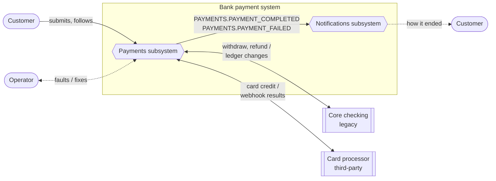

# Payment System Specification (L1)

*The bank's payment system seen from the [system hexagon (L1)](System_Hexagon_Guidelines.md): its subsystems as black boxes, the external events between them, and one spec per subsystem. A minimal teaching core, for showing the book's patterns. The payments subsystem's inside (L2) is in [PaymentsServiceSpecs.md](PaymentsServiceSpecs.md); keep the two consistent.*

**What's the book's and what's ours:** the subsystem idea, external domain events, the envelope and hub-to-hub forwarding are the book's. The subsystems, event names, fields and reasons are **ours**, designed for the JUG talk.

## Contents

1. [Domain](#1-domain)
2. [Subsystems](#2-subsystems)
3. [Context map](#3-context-map)
4. [External event catalog](#4-external-event-catalog)
5. [Subsystem specs](#5-subsystem-specs)
6. [Rule check](#6-rule-check)
7. [Decisions](#7-decisions)

---

## 1. Domain

**Capability:** a customer pays from their checking account to a card, and follows the payment until it ends.

| Actor | Kind | Role |
|---|---|---|
| Customer | User | Submits a payment and follows it |
| Operator | User (operations) | Gets `fault` events. Money problems (a rejected refund, a call that timed out) are fixed **in core checking**, with the payment's reference, and the ledger change flows back in as usual; faults from unreadable input are resubmitted once the cause is fixed (Ch. 4 › [Fault events](Chapter_04_Trusting_Facts_and_Eventual_Consistency.md#fault-events)) |
| Core checking | Legacy system | Debits the source account, and credits it back for a refund. Checks that the account exists, is open and is the customer's. Heard through its ledger changes |
| Card processor | Third-party service | Credits the card; answers later by webhook |

**Domain events**, in timeline order (internal or external is decided in [section 4](#4-external-event-catalog)):

| # | Event | Raised by | |
|---|---|---|---|
| 1 | Payment submitted | Customer | |
| 2 | Funds withdrawn / Withdrawal failed | Core checking | A failed withdrawal ends the payment: nothing to undo |
| 3 | Funds deposited / Deposit failed | Card processor | A failed deposit starts the refund |
| 4 | Funds refunded | Core checking | The compensation |
| 5 | Payment completed / Payment failed | The payment process | The **outcome**: at most one per payment |
| 6 | Payment expired | The payment process | A step missed its deadline. Not an outcome: a late answer still counts |

**Policies:** submitted → withdraw; withdrawn → deposit; deposited → completed; withdrawal failed → failed; deposit failed → refund, then failed once refunded; a step past its deadline → expired. **Anything unexpected** (a rejected refund, conflicting answers) becomes a `fault` for the operator.

---

## 2. Subsystems

| Subsystem | Dominant actor | Capability | Why this boundary |
|---|---|---|---|
| **Payments** | The customer | Pay from a checking account to a card, and follow the payment until it ends | One actor, one activity with high temporal cohesion (Ch. 2 › [By business capability](Chapter_02_Defining_Boundaries_and_Letting_Go.md#by-business-capability)) |
| **Notifications** | The customer, as the one being told *(assumed)* | Tell customers how their payments ended | Changes for its own reasons (channels, wording); shows external events leaving payments. Not designed here |

- **Legacy (L1.2, recommendation):** core checking is used only by payments, so it's wrapped by ESGs **inside payments** rather than given a subsystem of its own.
- **Left out on purpose:** an accounts subsystem (core checking checks the source account at withdrawal; the customer app gets the account list from outside payments, *assumed*) and bank transfers (the destination is always a card).

---

## 3. Context map

Each subsystem is a black box with its own event hub. External events flow upstream (left) to downstream (right). The customer is drawn twice so lines don't cross.



| Outside actor | Kind | Home subsystem | What flows |
|---|---|---|---|
| Customer | User | Payments (told by Notifications) | Submits payments and follows them in the customer app |
| Operator | User (operations) | Payments | Gets payments' `fault` events; fixes money problems in core checking, resubmits faults from unreadable input |
| Core checking | Legacy system | Payments | Withdrawals and refunds out; posted or rejected ledger entries back |
| Card processor | Third-party service | Payments | Card credits out; results back by webhook |

---

## 4. External event catalog

| Type | Owner | Consumers | Meaning |
|---|---|---|---|
| `PAYMENTS.PAYMENT_COMPLETED` | Payments | Notifications | The money reached the card |
| `PAYMENTS.PAYMENT_FAILED` | Payments | Notifications | The payment ended without reaching the card, and any money taken was returned; carries a public `reason` |

**Format (L1.8):** owned by payments, published as a JSON Schema. The book's envelope; the content is ours.

```json
{
  "id": "…",
  "type": "PAYMENTS.PAYMENT_FAILED",
  "timestamp": 1731073320000,
  "partitionKey": "p-7",
  "tags": { "source": "payments-egress-gateway" },
  "payment": {
    "id": "p-7",
    "customerId": "u-42",
    "amount": "100.00",
    "currency": "USD",
    "submittedAt": 1730900520000
  },
  "reason": "insufficient-funds"
}
```

- **Shared (L1.7):** payment id, `customerId` (so Notifications can reach the customer), amount, currency, submitted time, and `reason` on failures only.
- **Not shared:** account and card numbers, `raw`, internal codes, step events, expiry (`PAYMENT_EXPIRED` stays internal).
- **Public `reason`:** `insufficient-funds` or `rejected`. Everything else (closed account, unknown account, someone else's account, declined card) is `rejected`, so account numbers can't be probed.
- **Changing it (L1.11):** add fields freely. A rename or removal takes three deployments, guarded by Notifications' consumer-driven contract tests. The talk's example: **`submittedAt` → `createdAt`**.

---

## 5. Subsystem specs

### Payments

- **Dominant actor / capability:** the customer. Pay from a checking account to a card, and follow the payment until it ends.
- **Users and frontend:** customers, in the customer app (one frontend); operators, who get payments' `fault` events and fix money problems in core checking (D10).
- **Outside systems it owns:** core checking (legacy), the card processor (third-party).
- **Consumes:** nothing from other subsystems.
- **Produces:** `PAYMENTS.PAYMENT_COMPLETED`, `PAYMENTS.PAYMENT_FAILED` (its JSON Schema), to Notifications.
- **Regions:** one (D3).
- **Guarantees:**
  - **At most one outcome per payment**, published as one external event; a redelivered event keeps its id. Every payment gets one, except the rare one whose step answered both ways (a conflict), which the operator settles by hand (D9). A payment whose refund was rejected gets its outcome once the operator has posted the refund in core checking.
  - `PAYMENTS.PAYMENT_FAILED` means any money taken was already returned.
  - Only outcomes leave the subsystem; steps and timeouts stay inside.

### Notifications

- **Dominant actor / capability:** the customer, as the one being told *(assumed)*. Tells customers how their payments ended.
- **Users and frontend:** the customer receives messages; channels not designed here.
- **Outside systems it owns:** none here.
- **Consumes:** `PAYMENTS.PAYMENT_COMPLETED`, `PAYMENTS.PAYMENT_FAILED`, from Payments.
- **Produces:** nothing in this system.
- **Regions:** one.
- **Guarantees:** not designed here. In the talk it's a bus and a log ([mocks](PaymentsMockSystemsSpecs.md)).

---

## 6. Rule check

Against [L1.1–L1.12](System_Hexagon_Guidelines.md#3-rules).

| Rule | Verdict | Note |
|---|---|---|
| L1.1 One reason to change | ok | Payments changes with how customers pay; Notifications with how they're told (assumed) |
| L1.2 Legacy (recommendation) | followed | Core checking wrapped by ESGs inside payments, its only user |
| L1.3 Every actor on the map | ok | Customer, operator, both outside systems; the one subsystem line is labeled |
| L1.4 One home per outside system | ok | Both in payments |
| L1.5 Only external events between subsystems | ok | |
| L1.6 Internal or external, one owner | ok | Prefix `PAYMENTS.` |
| L1.7 Curated | ok | |
| L1.8 Owner's format, downstream translates | ok | Nothing comes in to translate |
| L1.9 One account per subsystem | **departs** | One account, a hub per subsystem: a teaching example (D2) |
| L1.10 Hub to hub, by agreement | ok | Payments forwards `PAYMENTS.*` to the Notifications hub |
| L1.11 External events change slowly | ok | Rename example `submittedAt` → `createdAt` |
| L1.12 Black box | ok | |

---

## 7. Decisions

Rebuilt from scratch on 2026-11-13 as a minimal teaching core (the earlier design is in git history).

| # | Decision |
|---|---|
| D1 | **Minimal scope:** two outside systems (core checking, card processor), one destination kind (card), one compensation (the refund). Bank transfers and an accounts subsystem are left out |
| D2 | **One cloud account** for the whole system, a hub per subsystem; the outside systems are in other accounts. Departs from L1.9 (Ch. 2 › [Creating subsystem bulkheads](Chapter_02_Defining_Boundaries_and_Letting_Go.md#creating-subsystem-bulkheads)) |
| D3 | **One region.** Departs from the book (Ch. 9 › [Running in Multiple Regions](Chapter_09_Running_in_Multiple_Regions.md)) |
| D4 | **Anything unexpected is a `fault`** for the operator. No operator API |
| D5 | **A deadline per step** (withdrawal, deposit, refund), to show the book's *expire* pattern; expiry stays internal |
| D6 | **Two public reasons:** `insufficient-funds`, `rejected` |
| D7 | **`PAYMENTS.PAYMENT_FAILED` comes only after any money taken was returned**: the simpler contract, since Notifications never needs a separate "refunded" event |
| D8 | The talk's contract-change example renames **`submittedAt` → `createdAt`** |
| D9 | **A conflict** (a step that answered both ways) ends with a `fault` and **no outcome**; the operator settles it by hand. Accepted for a case this rare, so the guarantee is *at most one* outcome |
| D10 | **The operator fixes money problems in core checking**, never by resubmitting: a rejected refund or a timed-out call is posted there by hand with the payment's reference, and the ledger change flows in through payments' usual path. Resubmitting would replay events whose ids consumers already dropped. Resubmission stays for faults from unreadable input |
