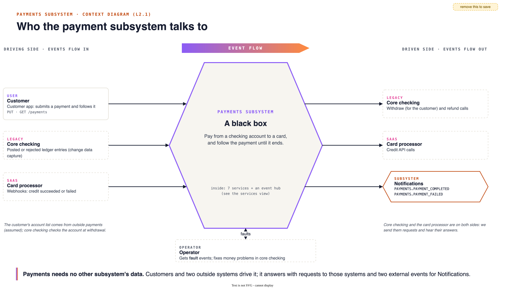
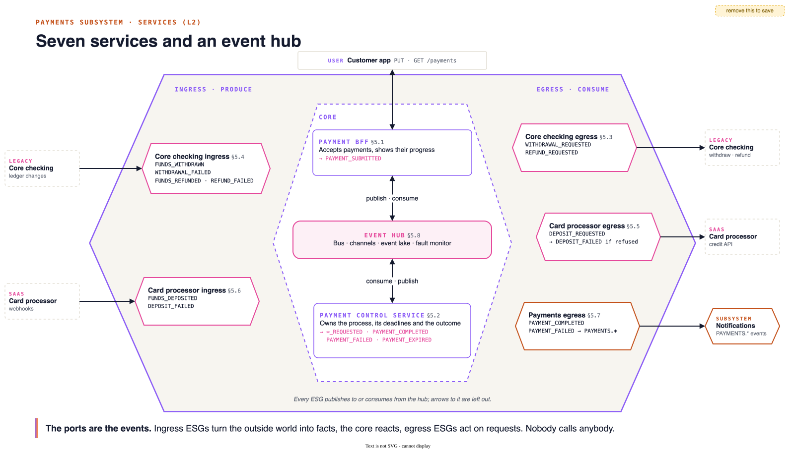

# Payments example

An autonomous payments subsystem built with kopipes, on plain AWS Lambda (`core` + `aws`, no Spring). A customer
submits a payment through a BFF; a control service runs the payment process (withdraw, deposit, refund if the deposit
fails, a deadline per step); gateways stand between the subsystem and the outside systems.

- [PaymentsSystemSpecs.md](PaymentsSystemSpecs.md): the system (L1), and the external event catalog.
- [PaymentsServiceSpecs.md](PaymentsServiceSpecs.md): each service as a black box (L2). The code follows it.



*The subsystem and the actors around it: the customer, the operator, core checking, the card processor and
Notifications ([PaymentsServiceSpecs.md › Context](PaymentsServiceSpecs.md#1-context)).*

Running example: payment `p-7`, 100 USD from checking account `C-1` to card `K-2`, for customer `u-42`.

## What is built



*The services inside the subsystem and the hub that connects them
([PaymentsServiceSpecs.md › Services](PaymentsServiceSpecs.md#4-services)).*

| Service | Status | Pattern | kopipes pieces |
|---|---|---|---|
| `payments-event-hub` | ✅ | Event hub | `EventHub` construct: bus, default channel `s1`, archive, logs |
| `payments-event-lake` | ✅ | Event lake | `EventLake` construct |
| `payments-event-fault-monitor` | ✅ | Fault monitor | `FaultMonitor` construct, `FaultMonitorTransform` |
| `payments-control-service` | ✅ | Control service | `CollectPipeline`, `CorrelatePipeline`, `EvaluatePipeline`, deadlines |
| `payments-bff` | ✅ | BFF | REST API, `MaterializePipeline`, `CdcPipeline` |
| `payments-core-checking-ingress-gateway` | ✅ | ESG ingress (legacy, CDC) | `TranslatePipeline`, `MaterializePipeline` |
| `payments-core-checking-egress-gateway` | ✅ | ESG egress (legacy, API call) | `ActionPipeline`, `CircuitBreaker` |
| `payments-card-processor-ingress-gateway` | ✅ | ESG ingress (third party, webhook) | `TranslatePipeline`, `RestApi` |
| `payments-card-processor-egress-gateway` | ✅ | ESG egress (third party, API call) | `ActionPipeline` (emitting), `RateLimiter` |
| `payments-egress-gateway` | ✅ | ESG egress (subsystem) | `CdcPipeline`, `EventForwarding` |
| `notifications-event-hub` | ✅ | A stand-in for the Notifications subsystem's hub | A bus, a log and an inbox queue |

The outside systems are simulated by their gateways (see [Simulation mode](#simulation-mode)), so a payment runs end
to end locally, and the account decides what happens to it.

## How a payment flows

```
                                        PAYMENT_COMPLETED / PAYMENT_FAILED ─► payments egress ─► our hub (external)
                                                                                     ─► egress rule ─► Notifications hub
customer ─PUT─► BFF ─► views table ─(stream)─► BFF trigger ─► bus: PAYMENT_SUBMITTED
                                                              │
         ┌────────────────────────── default channel ◄────────┘
         ▼
control service listener ─► events table ─(stream)─► control service trigger ─► bus: WITHDRAWAL_REQUESTED
                                                                                 │
   core checking egress ─► core checking ◄────────────────────────────────────────┘
                              │ (its ledger, through change data capture)
   core checking ingress ◄────┘ ─► bus: FUNDS_WITHDRAWN ─► … ─► DEPOSIT_REQUESTED
                                                                   │
   card processor egress ─► card processor ◄───────────────────────┘
                              │ (its webhook)
   card processor ingress ◄───┘ ─► bus: FUNDS_DEPOSITED ─► … ─► PAYMENT_COMPLETED
         ▲
BFF listener ─► views table: what each payment has heard ─► GET /payments/p-7
```

Every service is a handful of Lambda functions around one table, and they only talk through the bus. The rest of this
page walks through how each piece uses the framework.

## The code, service by service

Each service has an `app` (the functions) and an `infra` (its CDK stack), like the `sut` example. In an `app`:

- **Handlers** (`Handlers.kt`, `RestApi.kt`) build their container once per Lambda container and run a batch through
  it. That's all they do.
- **Containers** (`*Container.kt`) wire the pipelines from an `AwsKopipesContext`: the composition root, and the
  place to read first. Tests build them with in-memory fakes. See [docs/Wiring.md](../../docs/Wiring.md).
- **Plain functions** hold the business: `Rules.kt`, `PaymentView.kt`, `PaymentRequest.kt`. No framework in them.

### Events (`common-app`)

Internal events are one sealed class, `PaymentEvent`, encoded with the framework's `KotlinxEventCodec`. Every event
carries the whole `Payment`, so no consumer ever calls back; failures add a `reason`. Amounts are decimal strings.
See [docs/EventImplementationKotlin.md](../../docs/EventImplementationKotlin.md).

### Control service

```
default channel ─► listener ─► events table ─► (stream) ─► trigger
                   collect      ▲                          ├─ correlate          pk = p-7
                                │                          ├─ deadlines ×3       pk = p-7.<step>-deadline, ttl
                                └── written back ──────────├─ rules ×8           → bus
                                                           └─ expiry rules ×3    → bus
```

- **Collect, then act.** The listener only writes each consumed event to the events table. Everything else happens
  from the table's stream, so the service never acts on a fact it hasn't recorded, and a redelivered event writes
  the same item again, which changes nothing.
- **Correlate.** The trigger saves each event again under its payment (`pk = p-7`). Querying `p-7` gives everything
  heard for the payment, in any order.
- **One evaluate pipeline per rule.** [Rules.kt](payments-control-service/app/src/main/kotlin/org/myorg/payments/Rules.kt)
  has the spec's rules as plain functions; [TriggerContainer.kt](payments-control-service/app/src/main/kotlin/org/myorg/payments/TriggerContainer.kt)
  turns each into a pipeline: the event it fires on (`eventFilter`), what must hold (`expression`, over the payment's
  correlated events: conflict is checked first), and what it emits (`emit`).
- **Deterministic ids.** `oneEventPerCorrelationKey()` gives an emitted event the id `<payment>.<rule>`
  (`p-7.start`, `p-7.next-step`...), so a rule that fires again, in a replay say, emits the same event, and every
  consumer drops the repeat. That's also why a payment never gets two outcomes from one rule.
- **Faults.** `conflict` and `refund-failed` emit nothing: their `emit` throws, and the framework turns the unit of
  work, with the payment's events, into a `fault` for the fault monitor.
- **Deadlines.** The event that starts a step also writes a deadline item with a TTL. When DynamoDB deletes it, the
  step's `onExpired()` rule emits `PAYMENT_EXPIRED` if the step still has no answer.
  See [docs/Deadlines.md](../../docs/Deadlines.md). Locally they're two minutes; a day (core checking) or an hour
  (the card) otherwise.

### BFF

- **`PUT /payments/{id}`** checks only the request's shape, then writes the payment with a condition, so a repeated
  `PUT` writes nothing: the same body returns the stored view, another body is `409`.
- **Accepted means published.** `PAYMENT_SUBMITTED` (`p-7.submitted`) comes from the views table's stream through a
  `CdcPipeline`, never from the request handler: no dual write, and once the API answered `202` the event will be
  published, even if the bus was down at that moment.
- **The view.** The listener's `MaterializePipeline` records `at_<TYPE>` (the event's own timestamp) for each event
  heard, keeping the first. `status` is computed when read, from *which* events were heard, never their order: the
  spec's first-match table in [PaymentView.kt](payments-bff/app/src/main/kotlin/org/myorg/payments/PaymentView.kt).
- `X-Customer-Id` is a stand-in for an access token. **It is not authentication and must not ship.**

### Core checking gateways

Core checking is a legacy system: it closes at night, is sometimes down, and has no idempotency keys. Its two
gateways are the subsystem's edge with it: **act, then hear back**.

- **Egress** ([CalledOnce.kt](payments-core-checking-egress-gateway/app/src/main/kotlin/org/myorg/payments/CalledOnce.kt)):
  an `ActionPipeline` per request type calls core checking and publishes nothing. Each request is **called once**:
  claimed in its own table before the call, so a redelivered event never calls twice. A call that timed out is never
  retried blindly (a second call could debit twice): it becomes a fault, and the operator checks the ledger. A
  `CircuitBreaker` (state shared in DynamoDB) stops calls while core checking is down or closed; the listener runs
  with stream retry and `retryAttempts = -1`, so requests wait on the channel, in order, instead of being dropped.
- **Ingress** ([Ledger.kt](payments-core-checking-ingress-gateway/app/src/main/kotlin/org/myorg/payments/Ledger.kt)):
  a `TranslatePipeline` turns ledger rows (change data capture; here, a table with a stream) into our events:
  semantic translation of core checking's codes into our reasons, an id per ledger entry, the row kept whole in `raw`.
  A row knows only its own entry, so the gateway remembers each `WITHDRAWAL_REQUESTED`'s payment
  (`MaterializePipeline`) and fills in the snapshot from it. A row heard before its request waits: a retryable error
  and stream retry, not a fault.

### Card processor gateways

The card processor is a third party: it limits our request rate, answers later by webhook, and supports idempotency
keys.

- **Egress** ([CardProcessor.kt](payments-card-processor-egress-gateway/app/src/main/kotlin/org/myorg/payments/CardProcessor.kt)):
  calls the credit API with the payment id as the **idempotency key**, so every retry is the same credit. Calls are
  **paced** by a `RateLimiter` whose per-second budget lives in DynamoDB, shared by every container; a `429` waits as
  long as the processor says, a `5xx` or a timeout backs off, and after a few attempts the request goes back to the
  stream. An accepted request is a promise, not a fact: nothing is published. The one exception: a request refused
  outright (`4xx`) will never get a webhook, so the gateway answers for the processor with `DEPOSIT_FAILED`
  (`ActionPipeline.actionEmitting`), and the refund runs.
- **Ingress** ([Webhooks.kt](payments-card-processor-ingress-gateway/app/src/main/kotlin/org/myorg/payments/Webhooks.kt)):
  `POST /webhooks/card-processor` checks the processor's HMAC signature (`401` otherwise), then runs the body
  through the same kind of `TranslatePipeline` as the ledger. **Answered means published:** `200` only once the event
  is on the bus; a webhook for a deposit it hasn't heard of yet, or a bus that's down, is a `503`, so the processor
  sends it again; a signed but unreadable body is a fault, then `200`. The event id comes from the webhook's own id,
  so a redelivered webhook is the same event.
- **Resubmitting its faults:** the fault keeps the body, and the resubmit tool sends it back to the same function as
  `{"Records": [{"value": "<body>"}]}`. The handler is a `RequestStreamHandler`, so one function takes both inputs: an
  API Gateway request is checked and signed as above. A resubmission skips the signature, because its bodies were
  verified when they arrived and only the operator can invoke the function. It goes down the same pipeline
  (`ResubmittedRecords` in `aws` reads it).

### Payments egress gateway

[Translation.kt](payments-egress-gateway/app/src/main/kotlin/org/myorg/payments/Translation.kt) decides what payments
tells the rest of the bank, and hides everything else: only the outcomes cross, as `PAYMENTS.PAYMENT_COMPLETED` and
`PAYMENTS.PAYMENT_FAILED`, with the payment id, customer, amount, currency and submitted time. Account and card
numbers, `raw`, the step events and `PAYMENT_EXPIRED` stay inside, and of the five internal reasons only
`insufficient-funds` is told apart: anything else is `rejected`, so accounts can't be probed.

- The external events are their own classes, owned by this gateway and published as a
  [JSON Schema](payments-egress-gateway/contract/payments-external-events.schema.json); a test checks that what is
  published has exactly the schema's fields. The internal events can change without touching the contract.
- It publishes onto **our own hub** with source `external`, so the default channel doesn't carry them back in. The
  hub's egress rule (`EventForwarding`, owned by this stack) forwards `PAYMENTS.*` to each downstream hub; EventBridge
  retries that delivery. The event lake keeps the external events too.
- **Changing the contract** (`submittedAt` → `createdAt`) takes three deployments, all in this gateway: publish both,
  wait for every consumer's contract tests to switch, then drop `submittedAt`. The internal events keep `submittedAt`.

### Simulation mode

Each egress gateway has one setting, `SIMULATE` (on locally, never in production). With it on, the gateway doesn't
call the outside system: it sends the answer that system would have sent, in its own format, to an SQS queue with a
delay; a simulator function then delivers it to the ingress gateway's real input (for core checking, a ledger row).
The ingress gateway can't tell the difference. The answer depends only on the account:

| Account | Simulated answer |
|---|---|
| `C-2` | Withdrawal rejected: insufficient funds |
| `C-9` | Withdrawal rejected: someone else's account (`account-not-found`) |
| `C-5` | Withdrawal posted, but the refund is rejected (account closed). Pair it with `K-3` |
| `K-3` | Card credit declined: a `credit.failed` webhook. Starts the refund |
| `K-4` | Card request refused outright (`4xx`): the egress gateway emits `DEPOSIT_FAILED` itself |
| `K-7` | Card credited, but after the deposit's deadline: `PAYMENT_EXPIRED`, then a late `PAYMENT_COMPLETED` |
| any other | Success |

For the card processor, the simulator signs the webhook with the ingress gateway's secret and posts it to its real
URL (both published as SSM parameters by the ingress stack).

### Common components

The event hub, event lake and fault monitor are each a few lines on top of the [`cdk`](../../cdk/README.md) module's
constructs. The fault monitor's function is the framework's `FaultMonitorTransform`.

## Testing

- **Unit tests** test the plain functions in isolation: the rules, the status table, the request's validation.
- **In process.** [ControlServiceTest](payments-control-service/app/src/test/kotlin/org/myorg/payments/ControlServiceTest.kt)
  runs the control service's real pipelines, one test per cell of the spec's decision table, against
  `EventsTableSimulator`: an in-memory events table whose writes come back as stream records, the way the real table
  feeds the trigger. Seconds, no LocalStack.
- **End to end.** [PaymentsITest](integration-test/src/integrationTest/kotlin/org/myorg/payments/PaymentsITest.kt)
  runs against LocalStack: it submits through the BFF, plays the missing gateways on the bus, and watches the
  default channel, the BFF's views and the fault monitor's notifications.

## Running it locally

Install LocalStack, `awslocal` and `cdklocal` as in [the sut example](../sut/README.md). Then, from this directory,
starting from a clean LocalStack (a long-running one can hang mid-run):

```bash
docker compose down && docker compose up -d
./deploy_stacks.sh -d        # -d resets LocalStack's state first; builds, tests and deploys every stack
./run_itests.sh              # logs land in .awslocal_logs
docker compose down
```

`examples/sut` uses the same LocalStack container: test one example at a time.

Try it by hand:

```bash
API=$(awslocal apigateway get-rest-apis --query "items[?name=='payments-bff-local-api'].id" --output text)
URL=http://localhost:4566/restapis/$API/local/_user_request_

curl -X PUT $URL/payments/p-7 -H 'X-Customer-Id: u-42' -H 'Content-Type: application/json' \
  -d '{"from":{"kind":"checking","account":"C-1"},"to":{"kind":"card","account":"K-2"},"amount":"100.00","currency":"USD"}'
curl $URL/payments/p-7 -H 'X-Customer-Id: u-42'

# Every event on the bus is logged:
awslocal logs filter-log-events --log-group-name /aws/events/payments-event-hub-local-bus-events
```
